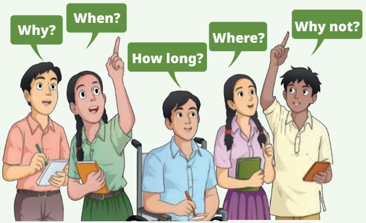

7. The following table contains information about the number of dengue cases reported in a hospital over a period of one year:

<table><tbody><tr><td>S. No.</td><td colspan="2">1</td><td colspan="2">2</td><td>3</td><td colspan="2">4</td><td>5</td><td>6</td></tr><tr><td>Month</td><td colspan="2">January</td><td colspan="2">February</td><td>March</td><td colspan="2">April</td><td>May</td><td>June</td></tr><tr><td>No. of dengue cases</td><td colspan="2">10</td><td colspan="2">12</td><td>15</td><td colspan="2">18</td><td>22</td><td>40</td></tr><tr><td>S. No.</td><td>7</td><td colspan="2">8</td><td colspan="2">9</td><td>10</td><td colspan="2">11</td><td>12</td></tr><tr><td>Month</td><td>July</td><td colspan="2">August</td><td colspan="2">September</td><td>October</td><td colspan="2">November</td><td>December</td></tr><tr><td>No. of dengue cases</td><td>65</td><td colspan="2">65</td><td colspan="2">65</td><td>30</td><td colspan="2">30</td><td>20</td></tr></tbody></table>

Make a bar graph of the number of cases on the Y-axis and the month on the X-axis. Critically analyse your findings and answer the following:

(i) In which three months were the dengue cases highest?

(ii) In which month(s) were the cases lowest?

(iii) What natural or environmental factors during the peak months might contribute to the increase in dengue cases?

(iv) Suggest a few preventive steps that the community or government can take before the peak season to reduce the spread of dengue.

8. Imagine you are in charge of a school health campaign. What key messages would you use to reduce communicable and non-communicable diseases?

9. It is recommended that we should not take an antibiotic for a viral infection like a cold, a cough, or flu. Can you provide the possible reason for this recommendation?

10. Which disease(s) among the following may spread if drinking water gets contaminated by the excreta from an infected person?

Hepatitis A, Tuberculosis, Poliomyelitis, Cholera, Chickenpox.

**Prepare some questions based on your learnings so far ...**.................................................................................................................................................................................................................................................................................................................................................................................................................................. Reprint 2026-27