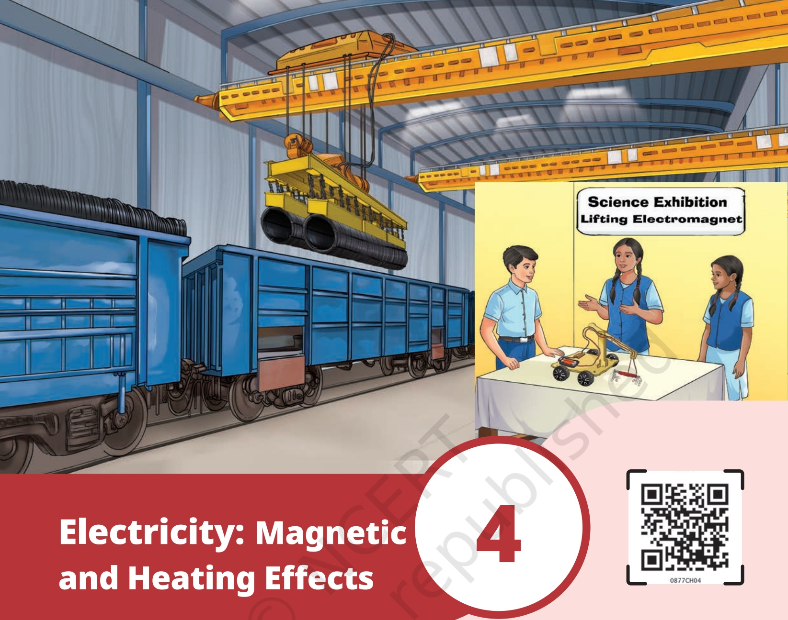
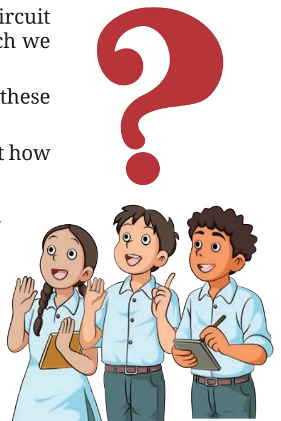

## Electricity: Magnetic and Heating Effects

**Probe and ponder**

z If we don’t have an electric lamp while making an electric circuit with an electric cell, is there any other way through which we can find out if current is flowing in the circuit?

z Is it possible to make temporary magnets? How can these be made?

z We can generate heat by burning fossil fuels and wood; but how is heat generated in various electrical appliances?

z How do we know if a cell or a battery is dead? Can all cells and batteries be recharged?

z Share your questions

