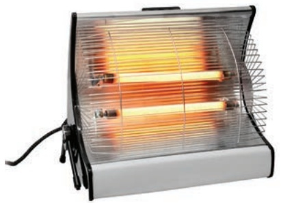
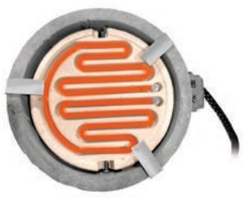
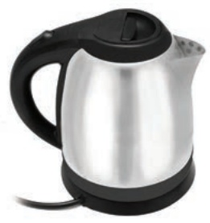
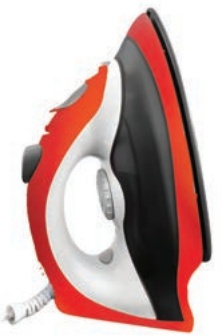
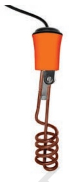
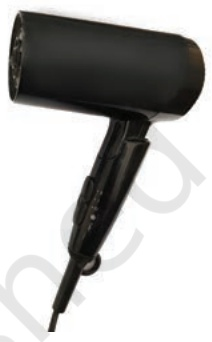
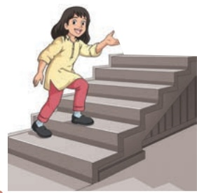

(a)

(c)

(b)

(d)

(e)

(f)

Fig. 4.6: Simple household electric heating appliances (a) Electric room heater; (b) Electric stove; (c) Electric kettle; (d) Electric iron; (e) Water heating immersion rod; (f) Hair dryer

## A step further

To prevent unnecessary heating in household switchboards, it is important to use appropriate wires, plugs, and sockets that are rated for the specified electric current of the connections.

The heating effect of electric current is useful in many everyday appliances. But sometimes, it can cause problems, like energy loss in wires during transmission. Overheating in appliances may cause damage to plugs and sockets where plastic parts may melt, or even lead to fires. In household circuits, there are safety devices placed in the circuit to minimise such incidents.

## Ever heard of ...

Beyond household use, heating effect of electric current has several industrial applications. One notable example is in steel manufacturing industries, where a specially designed high-temperature furnace (an enclosed space built to generate heat) uses electric current to produce heat. This is used to melt and recycle scrap steel, converting it into usable steel.