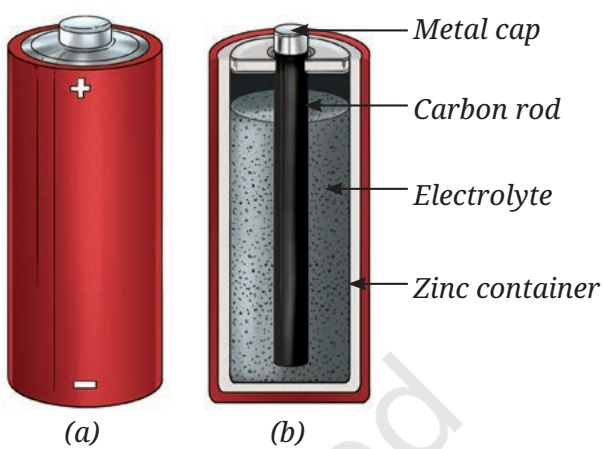
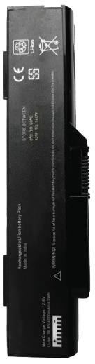
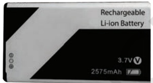
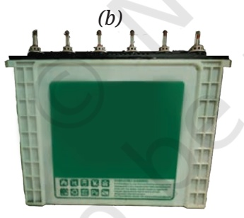
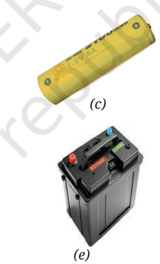
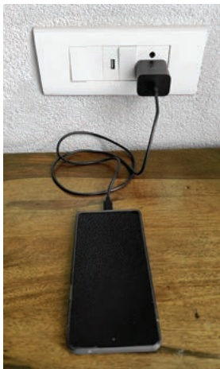

## 4.3.2 Dry cells

Voltaic cells were an important discovery, but they are not convenient for everyday use. Instead, dry cells are one of the most

widely used electric cells today. They are called ‘dry’ because the electrolyte is not a liquid but a thick moist paste. The structure of a dry cell is shown in Fig. 4.9. It consists of a zinc container which acts as a negative terminal and a carbon rod at the centre covered with metal cap that acts as the positive terminal. The carbon rod is surrounded by the paste-like electrolyte.

The dry cell is a single use cell, meaning once it is used up, it has to be disposed of. For several applications, rechargeable batteries are increasingly being used now.

Fig. 4.9: (a) Dry cell; (b) Its internal structure

## 4.3.3 Rechargeable batteries

Rechargeable batteries can be recharged and reused multiple times. This prevents wastage and saves money over time as well.

(a)

(d)

Fig. 4.10: Typical rechargeable batteries used in (a) Laptops; (b) Mobile phones; (c) Camera; (d) Inverter; (e) Vehicles

Fig. 4.11: Charging a mobile phone

There are many different kinds of rechargeable batteries that are used for different applications—from small <u>batteries used</u> in watches and phones to batteries used in laptops and tablet to bigger batteries that run inverters or drive electric vehicles (Fig. 4.10). However, rechargeable batteries also do not last forever. After being charged (Fig. 4.11) and used many times, they slowly wear out.

Oh, so this is the reason why after a year or two, the phone battery requires charging more often!

