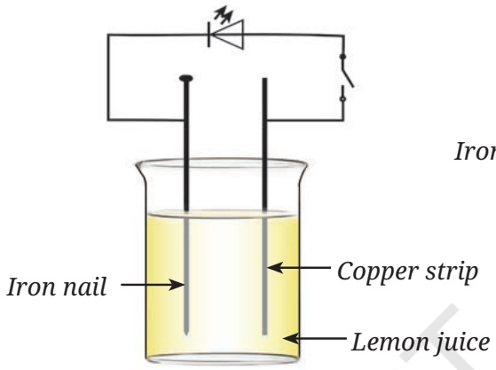
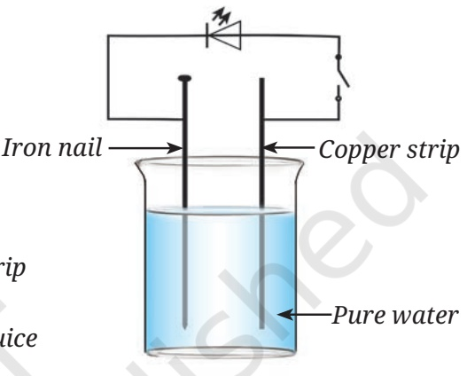
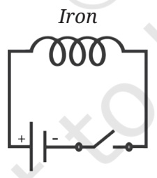
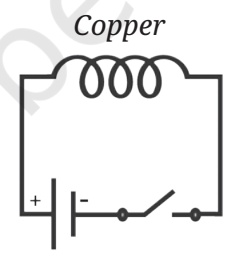
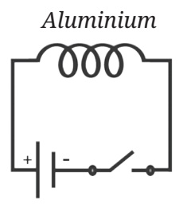
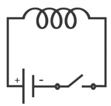
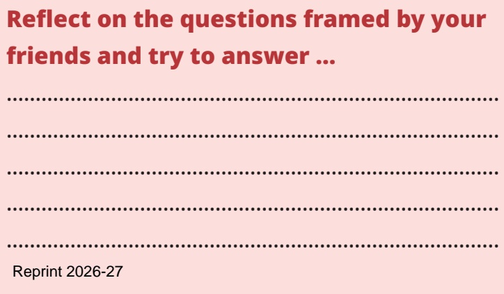

8. Suppose Sumana forgets to move the switch of her lifting electromagnet model to OFF position (in introduction story). After some time, the iron nail no longer picks up the iron paper clips, but the wire wrapped around the iron nail is still warm. Why did the lifting electromagnet stop lifting the clips? Give possible reasons.

9. In Fig. 4.12, in which case the LED will glow when the switch is closed?

(a)

Fig. 4.12

(b)

10. Neha keeps the coil exactly the same as in Activity 4.4 but slides the iron nail out, leaving only the coiled wire. Will the coil still deflect the compass? If yes, will the deflection be more or less than before?

11. We have four coils, of similar shape and size, made up from iron, copper, aluminium, and nichrome as shown in Fig. 4.13.

Fig. 4.13

**Reflect on the questions framed by your friends and try to answer ...**

