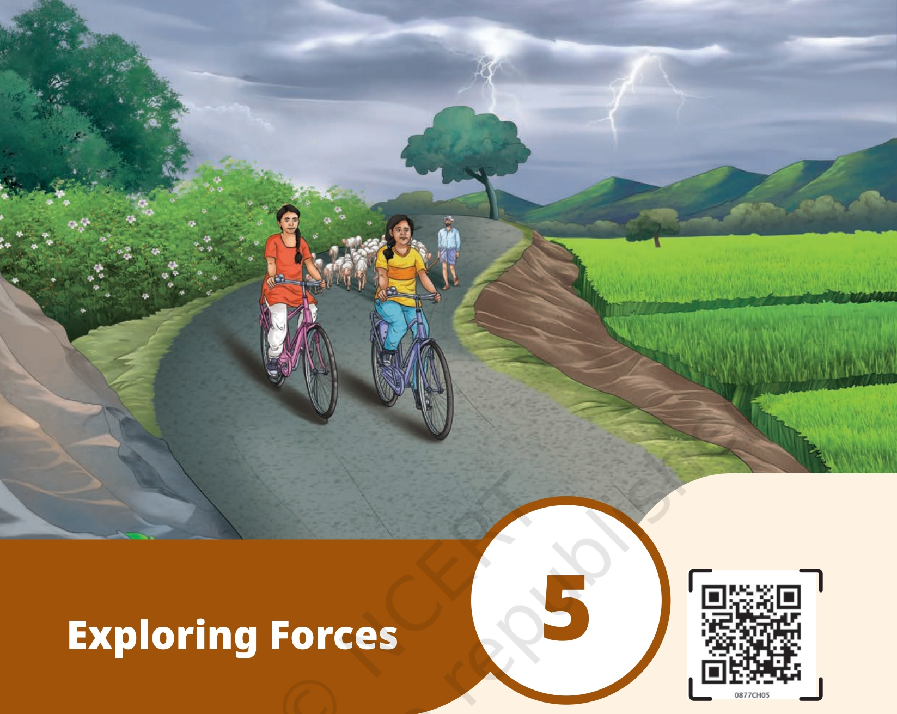

# Exploring Forces

z Why does it feel harder to pedal a bicycle when going up hill than on flat ground?

z Why is it easier to slip on a wet surface?

z Why do we feel ‘light’ or like we are ‘floating’ just aft er our swing reaches its highest point and begins to come down ?

z Share your questions