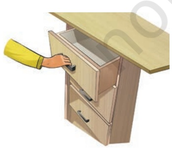
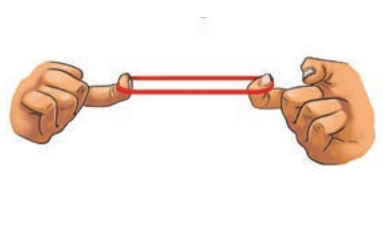
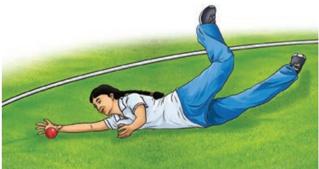

## 5.2 What Can a Force Do to the Objects on Which It Is Applied?

We experience push or pull in our daily lives all the time, often without even realising it. Let us recall some of these experiences and **analyse** them.

## Activity 5.2: Let us analyse

**Think** of situations where a force (push or pull) is applied and list them in Table 5.1.

z Analyse each situation and write the effect of the force in Table 5.1. Some situations and their effects are already listed for you.

~~Table 5.1: Different actio~~ns and their effects

| S.No. | Action Push/Pull | Effect |
| --- | --- | --- |
| 1. | Your friend holding Pull your moving bicycle from behind to stop it | Stopping or decreasing the speed of the bicycle |
| 2. | Hitting a moving ball Push with a bat | Changing the direction of a moving ball |
| 3. | Pressing an inflated Push balloon………………… ………………… | Change in shape of the balloon………………… |

What do you **conclude** from these examples? Does a force cause a moving object to stop? Can it change speed, or direction of motion, or change the shape of an object?

Fig. 5.2: Applying force on objects

