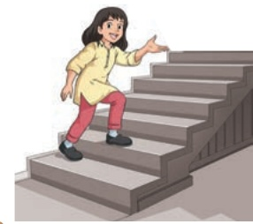
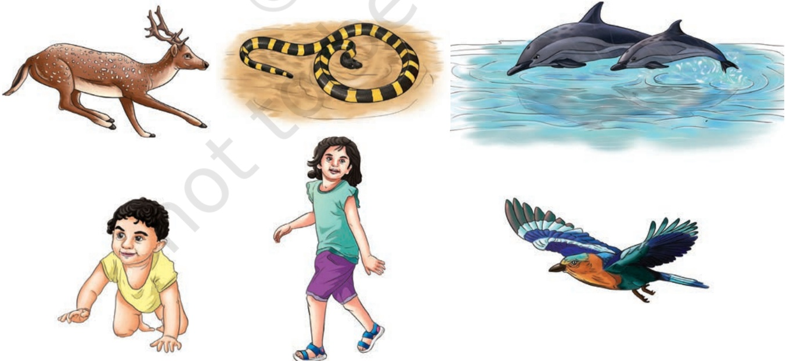

## A step further

When you pushed the table with your hand, did you feel a force on your hand too? The moment you stopped pushing, the force on your hand disappeared. Whenever two objects interact, each object experiences a force from the other. As soon as the interaction ceases, the two objects no longer experience the force.

## 5.4 What Are the Different Types of Forces?

## 5.4.1 Contact forces

In many situations, we find that to apply a force on an object, physical contact is necessary between our body and the object. This contact can be direct, such as using our hands or other body parts, or indirect, such as using a stick or rope. Forces of this type which act only when there is physical contact between the objects are called **contact forces**.

## Muscular force

An example of contact force is muscular force. When we perform any physical activity, such as walking, running, lifting, pushing, jumping, or stretching, the force is caused by the action of muscles in our body. The force resulting due to the action of muscles is known as muscular force. **Muscular force** occurs when muscles contract and elongate while doing any activity.

Animals, birds, fish, and insects use muscular forces for movement and survival (Fig. 5.3).

Fig. 5.3: Use of muscular force by living beings