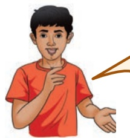
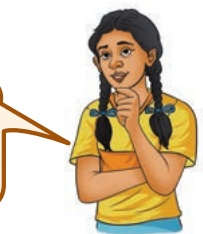
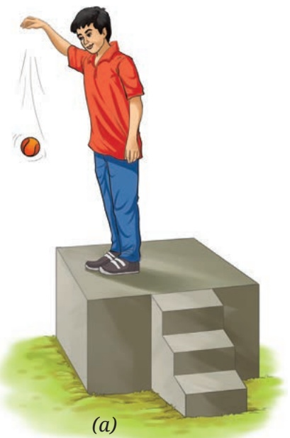
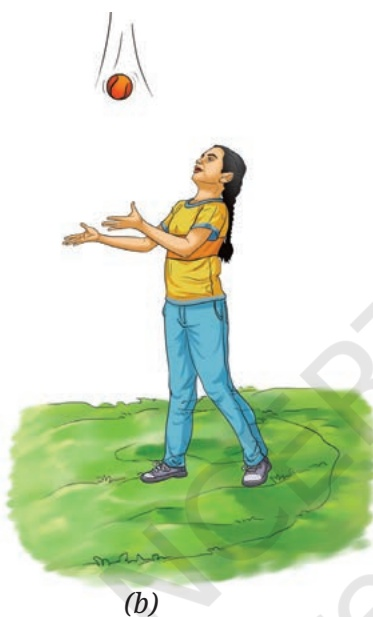
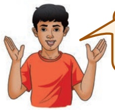

Why do all the objects fall towards the Earth?

Is there any force which acts on them? What exerts this force?

Since all the objects fall towards the Earth, it means the Earth attracts (pulls) them. The force with which the Earth attracts objects towards itself is called the **gravitational force**. The gravitational force exerted by the Earth is also called **force of gravity** or simply **gravity**.

Fig. 5.11: (a) Dropping an object from a height; (b) Throwing an object vertically upwards

Since the gravitational force acts without contact with the object it attracts, it is a non-contact force. Gravitational force is always an attractive force, unlike magnetic force or electrostatic force, which can either be attractive or repulsive.

You might have noticed that when an object is dropped from a height, it takes a straight vertical path downwards before touching the ground (Fig. 5.11a). When an object is thrown vertically upwards, the object moves up straight, slows down, stops momentarily at the top, and then takes a straight vertical path downwards (Fig. 5.11b).

While going up, the speed

of the object goes on decreasing till the object comes to a stop, its direction of motion changes and while coming down the

Does the Earth pull every object with equal force?

speed goes on increasing. We say that the object undergoes a **vertical motion** when it moves in a vertical direction under the influence of the gravitational force.

## 5.5 Weight and Its Measurement

The force with which the Earth pulls an object towards itself is called the **weight** of the object. The weight measures how strongly an object is pulled by the Earth. Since the weight is a force, it is measured in the same unit as that of force. Therefore, **SI unit of weight** is also **newton (N)**.