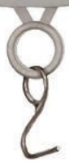
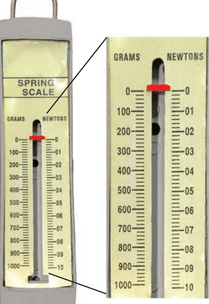
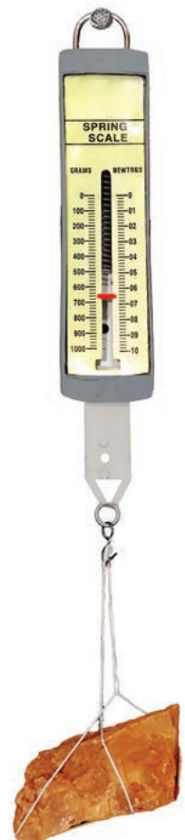

Fig. 5.13: A spring balance and close-up of its scale

Let us now try to find the smallest value of weight that can be measured by the spring balance.

## Activity 5.11: Let us calculate

z Look at the spring balance shown in Fig. 5.13 and note down the following:

{ How much is the weight difference indicated between the two bigger marks?

The weight difference indicated between 0 and 01 N or between 01 N and 02 N is 1 N.

{ How many divisions (shown by smaller marks) are there between these two bigger marks?

There are 5 divisions between these marks.

{ How much weight does one small division indicate?

One small division can read $\frac{1\mathrm{~N}}{5}=0.2\mathrm{~N}$

So, the smallest value that the spring balance can read is 0.2 N.

Now using this method, calculate the smallest value of weight that can be measured with the spring balance given to you. Your school laboratory may have spring balances for which the range and the value of the smallest division may be different. It is, therefore, always necessary to look carefully at the spring balance (or any other instrument) you are about to use.

Fig. 5.14: Object suspended from a spring balance

<u>Let us now learn how to</u> <strong><u>measure</u></strong> <u>weight using a spring balance</u>.

## Activity 5.12: Let us measure

z Take a spring balance and a few objects. Keep in mind that the objects should not be heavier than the maximum value of weight the spring balance can measure, otherwise it may get damaged.

z Suspend the objects one by one from the hook (Fig. 5.14). Read the scale for weight carefully and record your observations in the Table 5.2.

Table 5.2: Measuring weight using a spring balance

| S.No. | Object Weight (N) |
| --- | --- |
| 1. | Pencil Box |
| 2. | Partially filled water bottle |