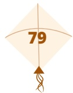
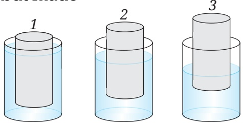
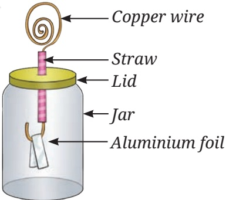

**Chapter 5 — Exploring Forces**

10. Three objects 1, 2, and 3 of the same size and shape but made

of different materials are placed in the water. They dip to different depths as shown in Fig. 5.17. If the weights of the three objects 1, 2, and 3 are $\mathsf { W } _ { 1 ^ { \flat } } \mathsf { W } _ { 2 ^ { \flat } }$ and $\mathbf { W } _ { 3 ^ { \flat } }$ respectively, then

(i) $W_{1} = W_{2} = W_{3}$

(ii) $W_{1} > W_{2} > W_{3}$

Fig. 5.17

(iii) $W_{2} > W_{3} > W_{1}$

$\mathsf{W}_{3} \geq \mathsf{W}_{1} \geq \mathsf{W}_{2}$

## Discover, design, and debate

z Collect objects made of different materials, such as plastic, wool, silk, rubber, polythene sheet, paper, and metals. Rub one material with another and check if it attracts small pieces of paper or not, that is, whether it gets charged or not. Record your observations in a systematic manner and write a research paper.

z Imagine a scenario where the gravity disappears. Develop a story. Create a cartoon strip to present your story.

z Organise a discussion in your class on the topic: Friction —a necessity or a problem? Make a note of the discussion and state where friction is a necessity and when it is a problem.

z Make your own spring balance with the help of your teacher and calibrate it using standard weights. Now measure the weights of different objects and calculate the ratio of the weight and mass of different objects. Do you observe a pattern?

z An electroscope is a device which can determine whether an object is electrically charged. You can make your own electroscope (Fig. 5.18) in your class with the help of your teacher, test the device. Explore in what other ways you may use this electroscope.

Fig. 5.18