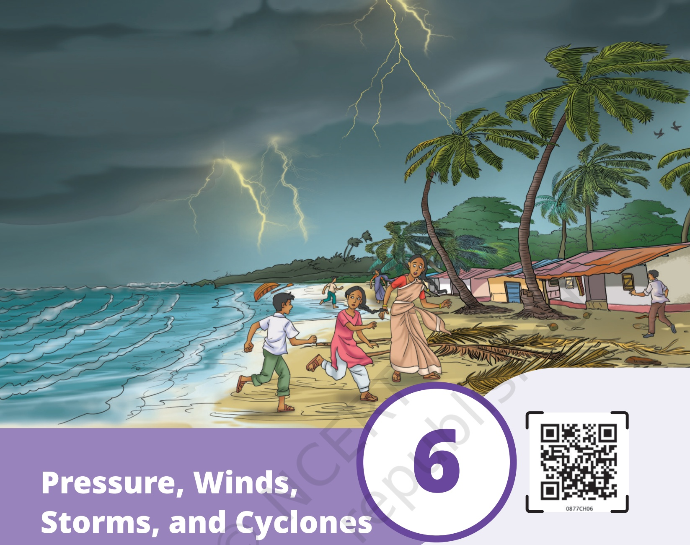

## Pressure, Winds, Storms, and Cyclones

## 6

**Probe and ponder**

z Why are winds stronger on some days than on others?

z Why are water tanks usually placed at a height?

z Can air pressure really crush us?

z What causes storms and cyclones? If the Earth stopped rotating, would cyclones still form?

z Share your questions

