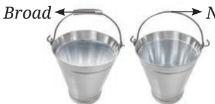
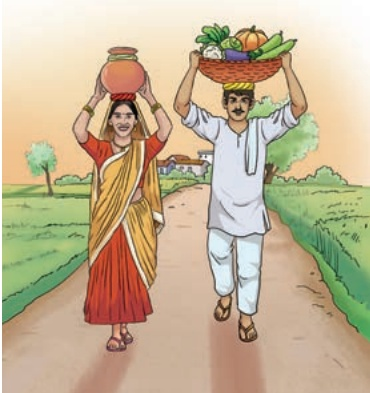
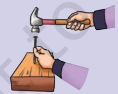
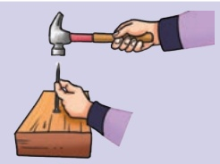
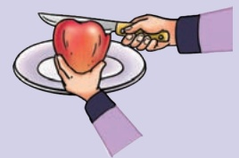
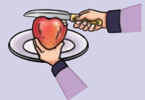

Broad straps reduce the pressure exerted by the bag onNarrow our shoulders as compared to narrow straps. Therefore, we feel more comfortable carrying a bag with broad straps.

Fig. 6.2: Buckets with broad and narrow handles

Fig. 6.3: Persons carrying loads

Can you now understand why it feels easier to lift a water-filled bucket with a broad handle than with a narrow handle (Fig. 6.2)? Similarly, we have seen that when people carry loads like pots or vegetable baskets on their heads, they often place a round piece of cloth under the loads (Fig. 6.3). In both cases, the objective is to reduce pressure by increasing the area over which the weight acts.

Pressure is defined as the force per unit area. The **SI unit** of **force** is **newton** and that of **area** is **metre**<strong>2</strong>. Therefore, the **SI unit** of **pressure** is **newton/metre2 (N/m2**). This unit is also called a **pascal**, denoted by **Pa**.

If a force of 100 N is applied on a cardboard of area 2 m2, then the pressure applied on the cardboard will be:

$$
\mathrm{pressure} = \frac{\mathrm{Fore}}{\mathrm{Area}} = \frac{100\mathrm{~N}}{2\mathrm{~m}^2} = 50\mathrm{~N/m}^2
$$

There are many situations in daily life where pressure plays a role. **Conduct** the activities given in Table 6.1 and **record** your observations. **Explain** how pressure influences the mode of action undertaken for each activity.

## Safety first

The activities listed in Table 6.1 should be conducted under the supervision of an adult.

~~Table 6.1: Reco~~rd your observations

<table><tr><td>Activity</td><td colspan="2">Modes of action</td><td>Easy or difficult to perform? Give reasons.</td></tr><tr><td>Driving an iron nail</td><td> By the head of the nail</td><td> By the pointed end of the nail</td><td></td></tr><tr><td>Cutting an apple with a knife</td><td></td><td></td><td></td></tr><tr><td colspan="2">Using the sharp edge of the knife</td><td>Using the blunt edge of the knife</td><td></td></tr></table>