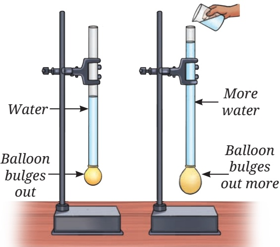
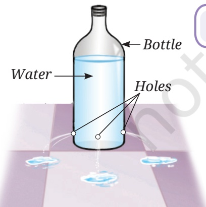

Fig. 6.6: Higher heights of water column produce bigger bulge of the balloon

What will happen to the bulge of the balloon if we increase the height of the water column?

Pour some more water in any one of the pipes used in Fig. 6.5. Observe the bulge of the balloon. Repeat this process a few times, adding more water each time and noting the extent of bulge as shown in Fig. 6.6.

Do you see any relation between the amount of bulge of the rubber balloon and the height of the water column in the pipe? You must have observed that the bulge of the balloon increases as the height of the water column increases.

Thus, as the height of the water column in the pipe increases, the pressure at the bottom of the pipe also increases, which causes the balloon to bulge more. So, we can say that the pressure exerted by a liquid in a vessel depends on the height of its column. This is the reason why overhead tanks are placed at a height so that the pressure in the taps is increased, resulting in a good stream of water from the taps.

Suppose you are living on the second floor of a three-storeyed building and an overhead water tank is placed on the top floor. Will you or your friend on the first floor receive a more powerful stream of tap water? Give reasons.

Do liquids also exert pressure on the walls of the container? Let us find out by conducting the following activity.

Fig. 6.7: Liquid exerts pressure on the wall of the container

## Activity 6.2: Let us find out

z Take a used plastic bottle and remove its cap. Make four small holes near the bottom around the sides using a needle or a nail. Make sure that the holes are at the same height from the bottom as shown in Fig. 6.7. (If you find it difficult to make a hole, you can slightly heat the needle and poke it to make holes.)

z Seal the holes with a tape and fill the bottle with water.

z Now, remove the tape from all holes at the same time.

What do you observe?