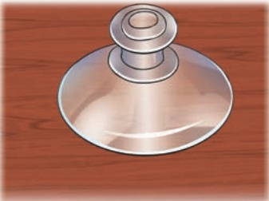

Have you ever wondered how large the atmospheric pressure is? Let us get an idea about its magnitude by performing the following activity.

## Activity 6.4: Let us perform

z Take a good-quality rubber sucker. Press it firmly against a smooth flat surface (Fig. 6.11).

z Do you realise that it sticks to the surface?

z Now, try to pull it off. Do you find it difficult to pull it off?

Fig. 6.11: A sucker

When we press the sucker, most of the air between its cup and the surface on which it is placed is pushed out and the air pressure inside it is reduced. The sucker sticks to the surface because the pressure of air surrounding the sucker is higher than the pressure exerted by the air inside the sucker. To pull the sucker off the surface, the applied force should be strong enough to overcome the pressure difference between outside the sucker and inside the sucker.

Do you know how large the atmospheric pressure is? The force exerted by the atmospheric air column over an area 15 cm × 15 cm is nearly equal to the force of gravity on an object of mass 225 kg (2250 N). The reason we are not crushed under this weight is that the pressure inside our bodies is also equal to the atmospheric pressure. This balances the pressure exerted from outside. The pressure inside our body is caused by the movement of fluids and gases in tissues and organs of the body.

## A step further

The SI unit of pressure is N/m2, also known as pascal (Pa). However, the practical unit of air pressure is millibar (mb), which is equal to 100 Pa. Air pressure is also expressed in hectopascal (hPa), which is equal to 100 Pa.

## 6.3 Formation of Wind

You must have noticed that on some days, the wind blows strongly, whereas on other days, it is calm. Sometimes, wind becomes so strong that it causes damage to life and property.

You must have seen that when an inflated balloon is kept without closing its mouth, the air from the balloon escapes. Recall that when there is a puncture in the bicycle tube, the air escapes and the tube collapses. In both of these cases, does air move from a high pressure region to a low pressure region?