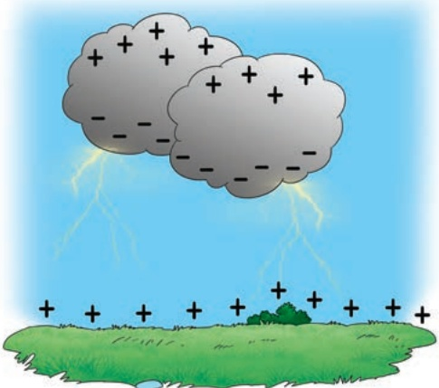
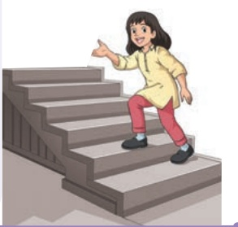
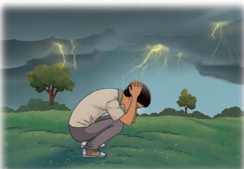

and ice particles. You have learnt in the chapter ‘Exploring Forces’ that when two objects are rubbed against each other, they get charged. In this case, strong winds blowing upwards and downwards and rubbing against each other cause static electric charges to develop within the clouds.

The positively charged lighter ice particles move upwards and occupy the upper part of the clouds. The negatively charged heavier water droplets occupy the lower part of the clouds. Thus, a charge separation within the cloud takes place. Also, when the negatively charged lower part of the cloud moves closer to the

Fig. 6.16: Lightning

ground, it causes the ground and nearby objects, such as trees or buildings, to become positively charged (Fig. 6.16).

Normally, air acts as an electrical insulator and does not let opposite charges meet. But when the build up of charges becomes very large, the insulating property of air breaks down. A sudden flow of charges takes place, producing a bright flash of light called **lightning**.

Lightning can occur as opposite charges collide within a cloud, between clouds, or between clouds and the ground. Lightning rapidly heats up the air around it, causing the air to expand and produce a loud sound known as **thunder**. A storm accompanied by lightning and thunder is called a **thunderstorm**.

## A step further

Isolated and localised thunderstorms can sometimes occur in various regions of India. These thunderstorms are known by various names such as Kalboishakhi in West Bengal, Bihar, and Jharkhand and Bordoisila in Assam. They occur before the arrival of the monsoon, thereby helping kharif crops to grow. In Kerala, Karnataka, and Tamil Nadu, they are known as mango showers as they support the ripening of mangoes. Local thunderstorms in Karnataka help in the growth of coffee plants.

Lightning can be dangerous! It can ignite fires, damage buildings, and cause severe burns or death in humans and animals. We must take necessary precautions and protect ourselves from lightning. During lightning, stay away from tall objects, find a low-lying open area and crouch down, and minimise contact with the ground. Do not lie down flat. Avoid using an umbrella with a metallic rod. If you are in water, get out of it. If you are inside a bus or a car, you are comparatively safer.

Fig. 6.17: Safe position during lightning