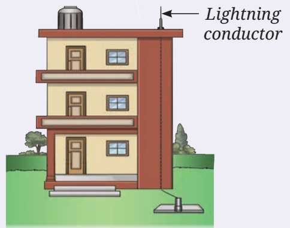
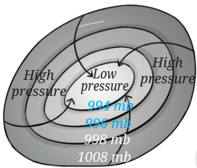
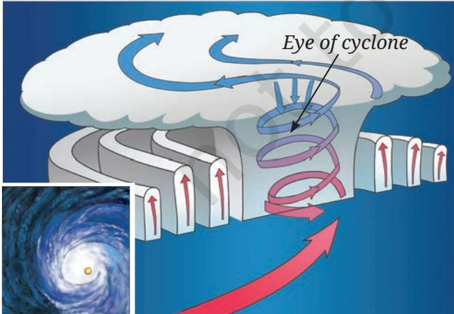
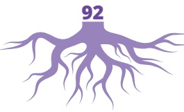

## Ever heard of ...

A lightning conductor is a metallic rod installed along the walls of buildings during their construction. One end of the rod is pointed. This end is kept higher than the highest point of the building (Fig. 6.18). The other end of the rod is buried deep in the ground. The rod provides easy path for the transfer of electric charges into the ground.

Fig. 6.18: A lightning conductor

## 6.6 Cyclone

**Cyclones** are large storms that form over warm ocean waters. As the ocean water gets heated, the warm and moist air above it rises. As the moist air rises, the water vapour condenses to

form raindrops. We know that during evaporation, water takes up heat to change into vapour. When this water vapour condenses into raindrops, heat is released back into the atmosphere. This causes further warming of the ascending air leading it to rise even further, creating an even lower pressure. Air from the surrounding regions rushes in and it also starts rising. Earth’s rotation causes the moving air to spin (Fig. 6.19). This cycle is repeated, resulting in the creation of a very low-pressure area with high-speed winds revolving around it. This spinning system of clouds, winds, and rain is called a **cyclone**.

Fig. 6.19: Winds blowing from high pressure areas to low pressure areas

Fig. 6.20: A cyclone

In a cyclone, the region of lowest pressure is at the centre, known as the **eye of the cyclone**. At the eye of the cyclone, the wind is calm, but the surrounding region experiences strong winds and heavy rainfall. As a cyclone moves from the ocean towards the land, it generates higher wind speeds compared to the wind speeds produced by regular thunderstorms. Once the cyclone reaches land, the source of moist air is cut off and it gradually loses its strength.

