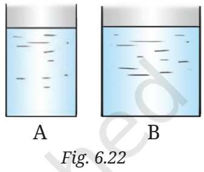
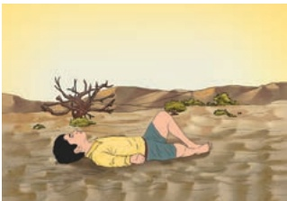
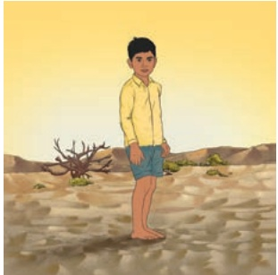
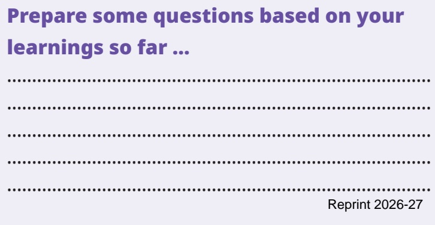

(iii) A water tank is placed on the roof of a building at a height ‘H’. To get water with more pressure on the ground floor, one has to

(a) increase the height $\mathrm { ^ { \circ } H ^ { \prime } }$ at which the tank is placed.

(b) decrease the height ‘H’ at which the tank is placed.

(c) replace the tank with another tank of the same height that can hold more water.

(d) replace the tank with another tank of the same height that can hold less water.

(iv) Two vessels, A and B contain water up to the same level as shown in Fig. 6.22. $\mathrm { P _ { A } }$ and $\mathrm { P _ { \mathrm { { } _ { B } } } }$ is the pressure at the bottom of the vessels. $\mathrm { F _ { A } }$ and $\mathrm { F _ { \mathrm { { \scriptsize ~ B } } } }$ is the force exerted by the water at the bottom of the vessels A and B.

$\mathrm{P}_{\mathrm{A}}=\mathrm{P}_{\mathrm{B}}, \mathrm{F}_{\mathrm{A}}=\mathrm{F}_{\mathrm{B}}$

$\mathrm{P}_{\mathrm{A}}=\mathrm{P}_{\mathrm{B}}, \mathrm{F}_{\mathrm{A}}<\mathrm{F}_{\mathrm{B}}$

$\mathrm{P}_{\mathrm{A}}<\mathrm{P}_{\mathrm{B}}, \mathrm{F}_{\mathrm{A}}=\mathrm{F}_{\mathrm{B}}$

(d) $\mathrm{P}_{\mathrm{A}}>\mathrm{P}_{\mathrm{B}}, \mathrm{F}_{\mathrm{A}}>\mathrm{F}_{\mathrm{B}}$

2. State whether the following statements are True [T] or False [F].

(i) Air flows from a region of higher pressure to a region of lower pressure. [ ]

(ii) Liquids exert pressure only at the bottom of a container. [ ]

(iii) Weather is stormy at the eye of a cyclone. [ ]

(iv) During a thunderstorm, it is safer to be in a car. [ ]

3. Fig. 6.23 a shows a boy lying horizontally, and Fig. 6.23 b shows the boy standing vertically on a loose sand bed. In which case does the boy sink more in sand? Give reasons.

4. An elephant stands on four feet. If the area covered by one foot is 0.25 m2, calculate the pressure exerted by the elephant on the ground if its weight is 20000 N.

Fig. 6.23 (a)

Fig. 6.23 (b)

