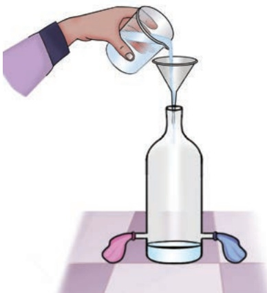
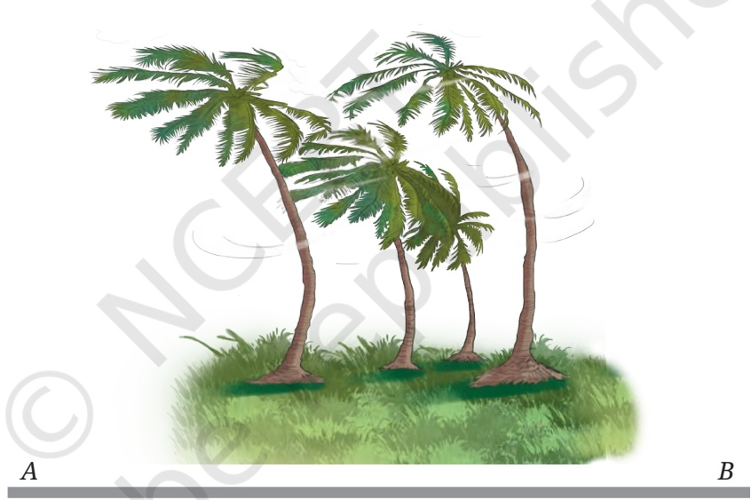
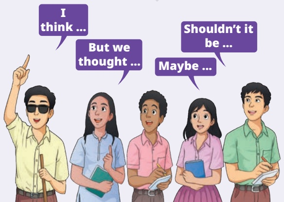

Fig. 6.24

5. There are two boats, A and B. Boat A has a base area of 7 m2, and 5 persons are seated in it. Boat B has a base area of 3.5 m2, and 3 persons are seating in it. If each person has a weight of 700 N, find out which boat will experience more pressure on its base and by how much?

6. Would lightning occur if air and clouds were good conductors of electricity? Give reasons for your answer.

7. What will happen to the two identical balloons A and B as shown in Fig. 6.24 when water is filled into the bottle up to a certain height. Will both the balloons bulge? If yes, will they bulge equally? Explain your answer.

8. Explain how a storm becomes a cyclone.

9. Fig. 6.25 shows trees along the sea coast in a summer afternoon. Identify which side is land— A or B. Explain your answer.

Fig. 6.25

10. Describe an activity to show that air flows from a region of high pressure to a region of low pressure.

11. What is a thunderstorm? Explain the process of its formation.

12. Explain the process that causes lightning.

13. Explain why holes are made in banners and hoardings.

**Reflect on the questions framed by your friends and try to answer ...**

