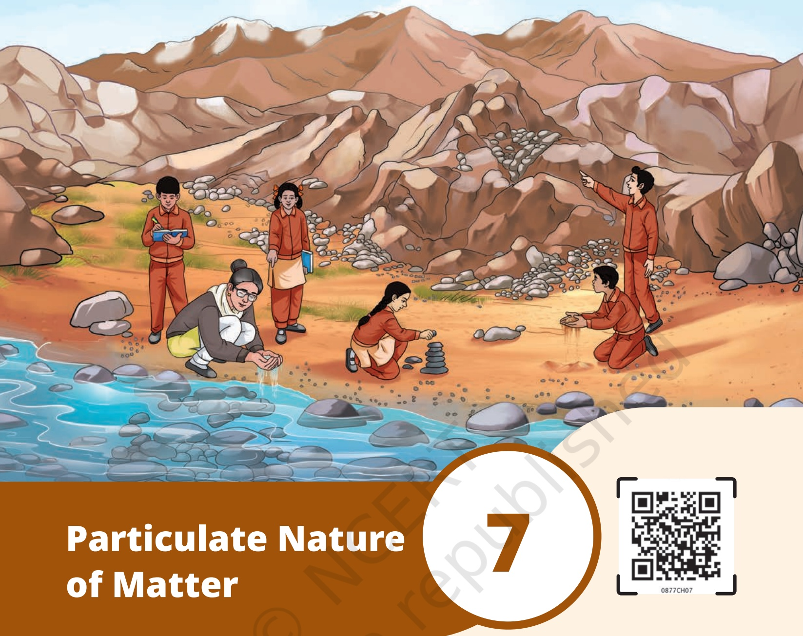

## Particulate Nature of Matter

z Why is it possible to pile up stones or sand, but not a liquid like water?

z Why does water take the shape of folded hands but lose that shape when released?

z We cannot see air, so how does it add weight to an inflated balloon?

z Is the air we breathe today the same that existed thousands of years ago?

z Share your questions