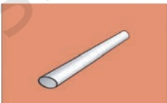
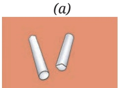
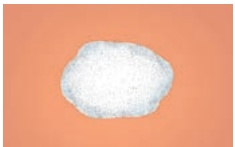
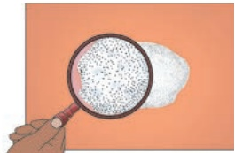

You might have collected pebbles and stones from the sand while playing on a riverbank or a beach. Where do these pebbles, stones, and sand come from?

In the mountains, rocks gradually break down due to erosion. Rivers flowing through these regions carry along the eroded rock pieces. As the rivers flow, they continue to break down the rocks further into pebbles, stones, sand; and transport large quantities of them to the plains.

The bigger rocks are eventually broken down into finer grains of sand and clay. Is this grain the smallest unit of a bigger rock or can these grains of sand and clay be broken down further? Let us find out!

## 7.1 What Is Matter Composed of?

## Activity 7.1: Let us explore

z Take a stick of chalk (Fig. 7.1a) and break it into two pieces (Fig. 7.1b).

z Continue breaking the chalk till it becomes difficult to break it further by hand.

z Grind the small pieces of chalk thus obtained (Fig. 7.1c) using mortar and pestle.

(c)

z **Observe** the fine powder of chalk with a magnifying glass (Fig. 7.1d).

(b)

What do you observe?

Each tiny grain you observe is still a speck of chalk.

Is every speck of this fine chalk powder still composed of the same substance, or has it changed into something else on breaking or grinding?

(d)

Recall Curiosity, Grade 7 chapter ‘Changes Around Us: Physical and Chemical’— is grinding chalk a physical change or a chemical change? You learnt that the chalk does not change into a new substance on grinding. It is a physical change in which only the size of each speck of chalk has reduced further.

Fig. 7.1: (a) A stick of chalk; (b) The chalk stick broken into two pieces; (c) A piece of chalk ground into fine powder; (d) A close-up view of chalk powder under a magnifying glass