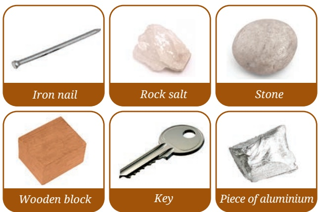
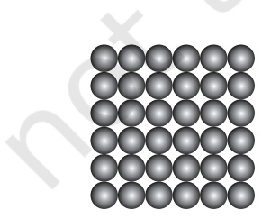
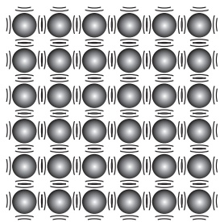
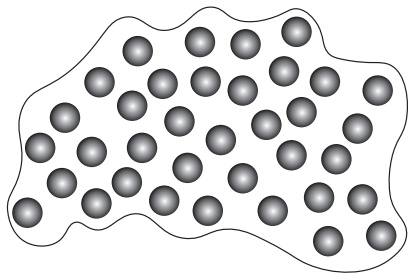

Fig. 7.3: Some solid objects

Let us explore how these attractions vary in different states.

## 7.2.1 Solid state

How are constituent particles held together in **solids**?

## Activity 7.3 : Let us find out

**Collect** a few solid objects, such as a piece of iron or an iron nail, a piece of rock salt, a stone, a piece of wood, a key, and a piece of aluminium (Fig. 7.3).

z Observe their shapes and sizes.

Try hammering them.

z In which of the above six objects do you think particles are strongly held together?

You must have noticed that all these objects are solids. They have a **definite shape** and **volume**. This is due to the fact that in solids, the particles are tightly packed and the interparticle attractions are very strong. These strong forces of attraction hold the particles in fixed positions, preventing them from moving freely (Fig. 7.4a).

In the solid state, is there any way to move these <u>particles apart?</u>

The particles can only move to and fro about their positions (vibrate or oscillate) but cannot move past each other.

When solids are heated, their particles vibrate more vigorously (Fig. 7.4b). A stage is reached when these vibrations become so vigorous that the particles start leaving their respective positions. The interparticle forces of attraction get weakened and the solid gets converted into the liquid state (Fig. 7.4c). The temperature at which this happens is the melting point of the solid.

(a) Solid

(b) Particles with increased vibrations

(c) Liquid

Fig. 7.4: Magnified schematic pictures of melting of a solid