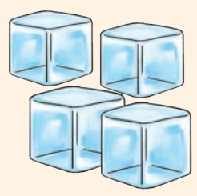

The minimum temperature at which a solid melts to become a liquid at the atmospheric pressure is called its **melting point**. Generally, in a liquid state, particles are somewhat farther away from each other as compared to those in the solid state (ice is an exception—its particles are farther apart than those in water).

Some solids have weak interparticle forces of attraction, so their melting points are low. While others have strong attractive forces and have high melting points. Some examples of solids and their melting points are shown in Table 7.1.

Table 7.1: Melting points of some solids

<table><tr><td>S.No.</td><td>Material</td><td>Melting point</td></tr><tr><td>1.</td><td>Ice </td><td> $0 ~ ^ { \circ } \mathsf { C }$ </td></tr><tr><td>2.</td><td>Urea </td><td> $1 3 3   ^ { \circ } \mathrm { C }$ </td></tr><tr><td>3.</td><td> Iron</td><td> $1 5 3 8   ^ { \circ } \mathrm { C }$ </td></tr><tr><td></td><td> liquids and gases?</td><td>Solids have a definite volume; what about</td></tr></table>