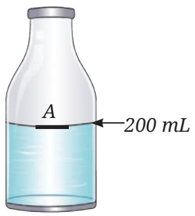
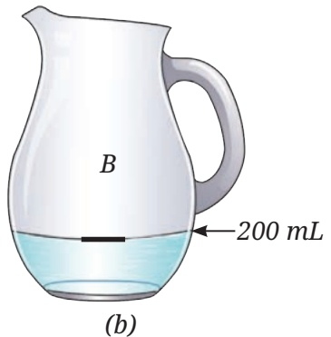
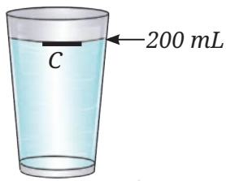
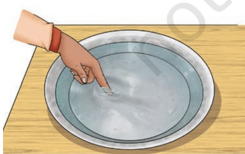

## 7.2.2 Liquid state

## Activity 7.4: Let us try and find out

(a)

(c)

Fig. 7.5: Water placed in containers of different shapes

z Take three clean and dry containers of different shapes. Label them A, B, and C (Fig. 7.5).

z Mark the 200 mL level in each container using a marker or by pasting a thin strip of paper.

Fill Container A with water up to the marked level.

z Carefully transfer the water from Container A to Container   B without spilling, and observe the shape and level of the water.

z Now, transfer the same water from Container B to ContainerC, carefully, and observe the shape and its level again.

You will notice that the water takes the shape of the container into which it is poured. So, we can say that the **liquids** do not have a fixed shape and take the shape of the container they are kept in. This happens because the particles of liquids are free to move. In all three containers, the water level remains at 200 mL and no change in volume is observed. Hence, we can say that liquids have a **definite volume**. However, if a container is not clean, some water may stick to its walls, causing the water level in the next container to be slightly less than 200 mL after pouring.

Fig. 7.6: Moving finger through water

Activity 7.4 shows that the particles of liquids can move freely, but only within a limited space. Therefore, we can **infer** that liquids have no fixed shape but have a fixed volume.

Let us now **compare** interparticle forces of attraction in liquids and solids. Take some water in a shallow vessel and try to move your finger through it (Fig. 7.6).

Are you able to move your finger through the water?