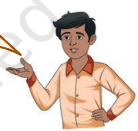
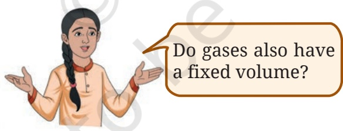

You can move your finger through water without breaking or cutting it permanently, which cannot be done in the case of solids. When you try this, you are temporarily displacing water. As soon as you remove your finger, the position of the water is restored. We can say that in liquids, the interparticle attractions are slightly weaker than in solids, but still strong enough to keep the particles close together.

Recall Curiosity, Grade 6 chapter ‘Temperature and Its Measurement’, where you observed the temperature of boiling water (liquid). When a liquid is heated, a stage comes when it starts boiling. The temperature at which a liquid boils and turns into vapour at atmospheric pressure is called its **boiling point**. The movement of particles becomes so vigorous that they move apart from each other, resulting in a decrease in the interparticle forces of attraction. Eventually, the constituent particles can escape from the liquid state. The liquid is converted into vapour or the gaseous state.

I have seen that spilled water disappears after some time, and it happens at any temperature!

At the boiling point, the formation of vapour is very fast and occurs not only at the surface but also within the liquid. This process is observed as bubble formation in the liquid. However, vapour formation occurs at all temperatures, even below the boiling point, though slowly and only at the surface. This slower process is known as evaporation— about which you have learnt in earlier grades.

## 7.2.3 Gaseous state

Do gases also have a fixed volume?

## Activity 7.5: Let us investigate

Take two transparent gas jars or glass tumblers and mark them A and B.

## Safety first

Be careful while burning an incense stick.

z Create some smoke by burning an incense stick.

z Hold the Gas Jar A upside down over the smoke (Fig. 7.7a).

z The gas jar should trap the smoke inside.

z Turn it over and cover it with a glass plate (Fig. 7.7b).

z Hold another Gas Jar B upside down and gently place it over the glass plate covering the Gas Jar A.