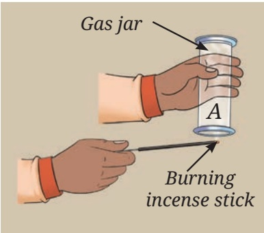
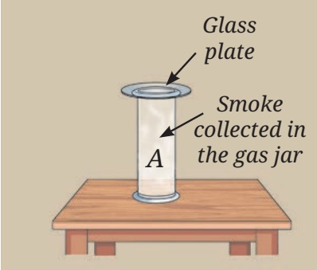
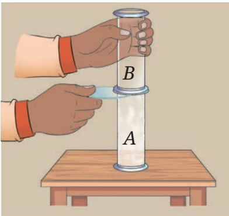
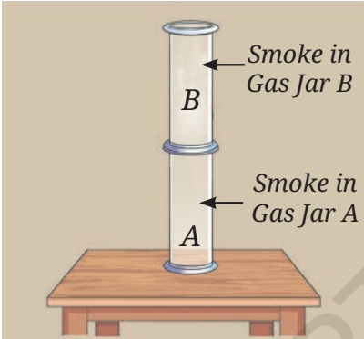
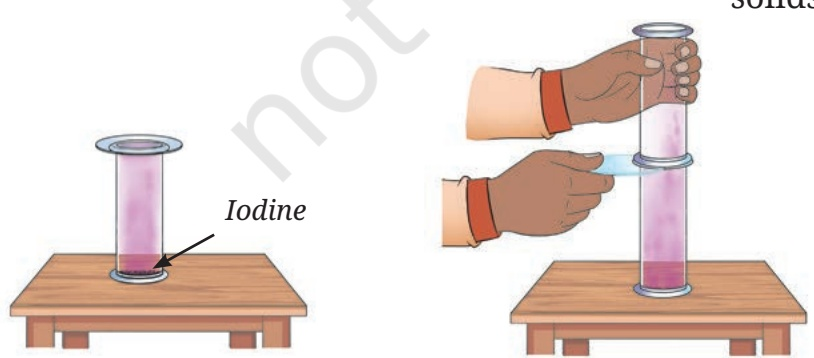
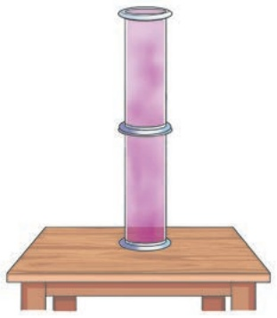

(a) Collecting smoke

(b) Covering the gas jar with a glass plate

Fig. 7.7: Smoke spreads freely inside the gas jars

(c) Placing the Gas Jar B and removing the glass plate

z Remove the glass plate slowly and ensure that both gas jars are close enough and there is no gap for smoke to escape (Fig. 7.7c).

Observe how the smoke spreads inside the Gas Jar B.

(d) Spreading the smoke

z The smoke fills the entire space in the Gas Jar B, indicating that gases do not have a fixed volume and tend to occupy the entire available space (Fig. 7.7d). Like liquids, they also acquire the shape of the vessel they are in.

This illustrates that the particles in gases move freely in all directions and the interparticle attractions are negligible. As a result, gases do not have a fixed shape or volume.

In this activity, smoke is used to

represent the gaseous state. The tiny particles of smoke suspended in the air are constantly hit by invisible particles of gases, and their movement helps us observe the motion of gas particles.

This activity can also be demonstrated by using iodine vapour instead of smoke from incense sticks.

## Safety first

Iodine vapour can be obtained by placing some solid iodine in a closed gas jar for some time, as shown in Fig. 7.8.

Be careful while using solid iodine. Vapours of iodine can cause irritation.

Both liquids and gases flow and do not retain a fixed shape. These properties distinguish them from solids and **classify** them as **fluids**.

Fig. 7.8: Iodine vapour spread freely inside the gas jar

