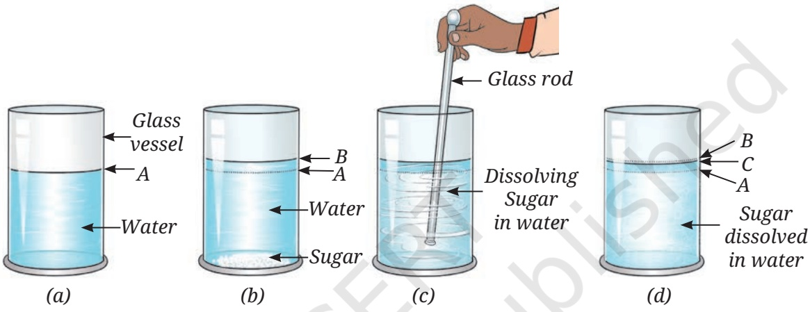
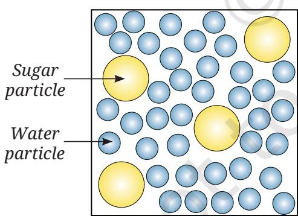

## Activity 7.7: Let us observe

z Take a glass vessel, fill it about half with water, and mark the level of water A (Fig. 7.10a).

z Add two teaspoons of sugar into it.

z Mark the new water level on the glass vessel B (Fig. 7.10b).

z Stir the water with a glass rod to dissolve the sugar (Fig. 7.10c).

**Predict** whether the water level will increase or decrease with respect to the mark B.

z Mark this water level again as C (Fig. 7.10d).

Fig. 7.10: Variation in water levels

What difference do you observe in the water levels?

You will observe that initially, when sugar is added, the level of water increases, but after dissolution, it may decrease to some extent. Since the volume of the solution is less than the sum of

Fig. 7.11: Magnified schematic picture of distribution of sugar particles in water

the volumes of water and sugar, it indicates that there is some space between the water particles. The particles of the dissolved substance occupy these spaces (Fig. 7.11).

Repeat the Activity 7.7 with some other soluble solids, such as common salt or glucose, and insoluble solids, like sand and stone pieces.

What do you observe in each case? Do the sand particles dissolve? Does the volume of water in the vessel change after mixing, and why?

Sugar and sand are both solids. Why does sugar dissolve in water but sand does not?