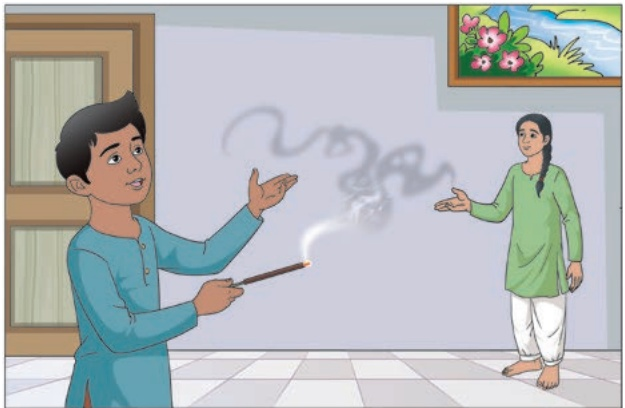
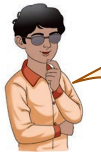
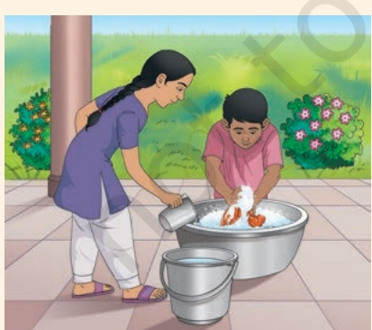

Fig. 7.14: Burning of an incense stick

When an incense stick is burnt in one corner of the room, initially, the fragrance is felt only around the incense stick. Shortly, you can smell the fragrance throughout the room. This happens because the particles of the fragrance spread, filling the entire room. This shows that the particles of air are moving constantly. The air particles hit the particles of the fragrance and help them spread throughout the room.

Oh! Now I know why and how the fragrance of perfume reaches us.

Can you share a few other real-life situations where you have experienced the movement of gas particles?

## Ever heard of ...

Fig. 7.15: Particles of soap help in cleaning

The particulate nature of matter plays a crucial role in many everyday processes. For example, when we wash clothes stained with oil using soap, numerous soap particles surround the oil particles on the fabric. One end of the soap particle attaches to the oil, and the other mixes with water, thus helping lift the oil off and wash it away (Fig. 7.15).

