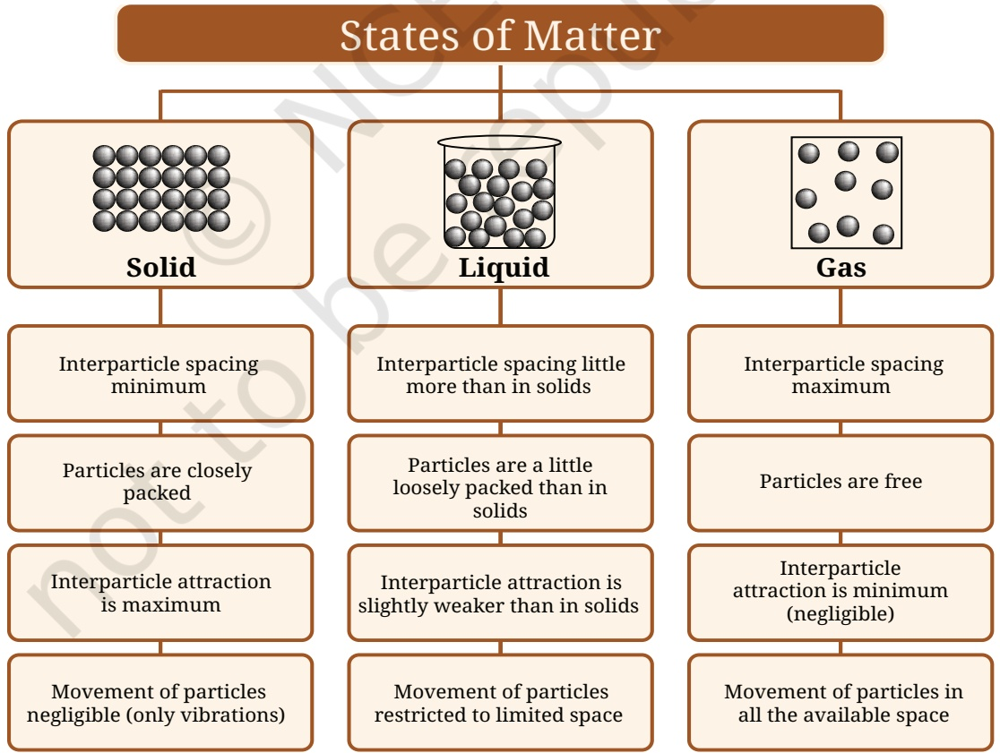

Based on our learnings from the chapter, we can say that matter is made up of small particles which are held together by the force of attraction. The strength of attractive forces between particles depends on the distance between them, which in turn depends on their thermal (heat) energy. Thus, it is the thermal energy of the particles that determines the physical state of matter. In the solid state, the thermal energy of particles is low, so they remain close to each other and experience strong interparticle attractive forces. This restricts their motion to only small vibrations.

At the melting point, the thermal energy is used to overcome the attractive forces between particles, allowing the solid to change into a liquid. At this stage, the particles can move away from their fixed positions. The interparticle distance increases slightly, reducing the strength of the attractive forces to a level that allows the particles to move around, though still within a limited space. In the gaseous state, the particles have enough energy to overcome the forces of attraction between them and move freely in all directions. You will learn more about these particles that constitute matter in higher grades.

## Let us wrap up!

Particle nature of the three states of matter–

