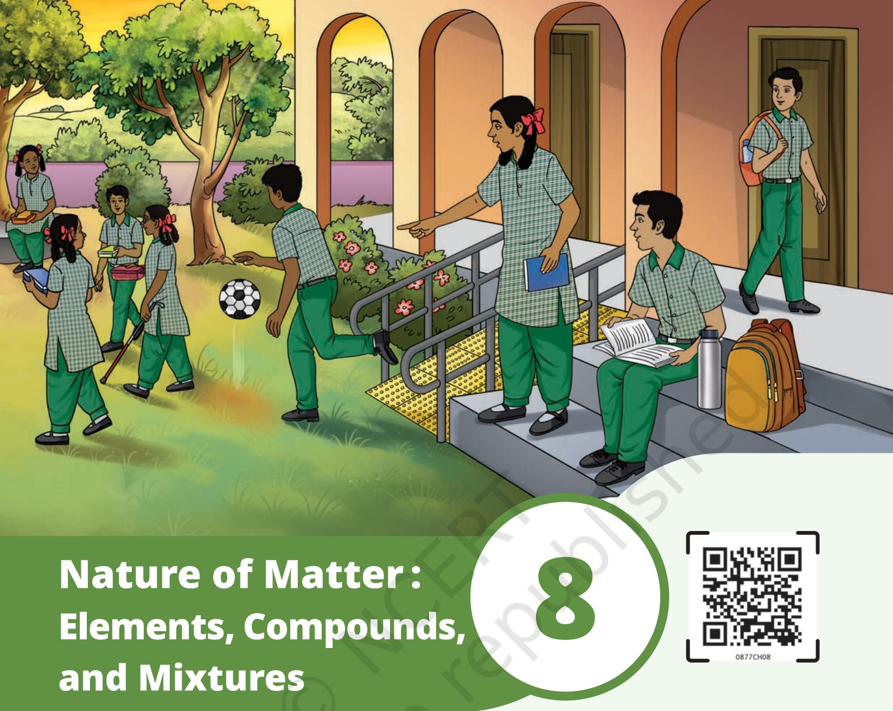

**Nature of Matter : Elements, Compounds, and Mixtures**

**Probe and ponder**

z Which of the entities in the picture above consist of matter, and which of them do not?

z How can elements be combined to form a compound?

z How could the discovery of a compound that absorbs carbon dioxide from the air contribute to solving environmental challenges?

z Share your questions

