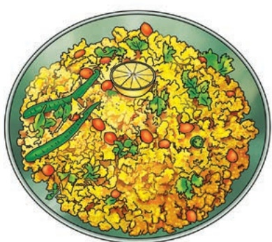
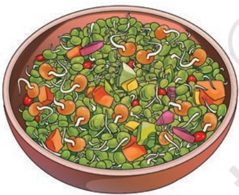
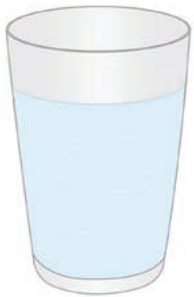

Have you ever wondered what the world around you is made of? Look around! The staircase you use, the air you breathe, the water in your bottle, the food in your lunch box, the clothes and shoes you wear, the book you read, the trees outside, the ball you play with and even the stick you carry—all of these are examples of **matter**, which you have learnt in earlier grades.

You have also learnt that all these things are made up of tiny particles. Most of the things around us are not made of just one substance; rather they are made up of two or more substances mixed together. Let us now understand how different substances come together to form mixtures.

## 8.1 What Are Mixtures?

Fig. 8.1: Poha

Have you ever wondered what makes your poha (Fig. 8.1) so delicious or how to make the perfect sprout salad? While these dishes may seem very different, they share something in common—they are both made by mixing several ingredients. We **observe** the mixing of substances in everyday life. Sugar dissolved in water is also a mixture, and so are soups and lemonade.

When two or more substances are mixed, where each substance retains its properties, it is called a **mixture**. The individual substances that make up a mixture are called its **components**. The components of a mixture do not react chemically with each other. In some mixtures, the components—like green gram, chickpeas, onion, and tomato in a sprout salad (Fig. 8.2), are easy to see. Such mixtures, where the different

Fig. 8.2: Sprout salad

components are generally visible with the naked eye or with a magnifying device, are **non-uniform** in nature. Can you **identify** a few more examples of non-uniform mixtures around you?

On the other hand, some mixtures have components that cannot be seen separately even with the help of a microscope. For example, sugar and water particles cannot be seen separately in their mixture. Such types of mixtures, where the components are evenly distributed and cannot be distinguished, are **uniform** in nature (Fig. 8.3). Can you list a few uniform mixtures?

Fig. 8.3: Uniform mixture of sugar and water