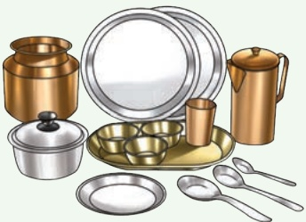

## A step further

Do you know that stainless steel is also a mixture? Stainless steel contains iron, nickel, chromium, and a small amount of carbon. They are mixed so uniformly that the entire mixture appears the same throughout and one cannot see the individual substances. Such mixtures are known as alloys. Brass, a mixture of copper and zinc, and bronze, a mixture of copper and tin, are some other examples of alloys (Fig. 8.4). s

Fig. 8.4: Utensils made of tainless steel, brass, and bronze

## Our scientific heritage

Mishraloha was the name given to the mixture of two or more metals that had properties distinct from its constituent metals. Ancient Indian texts, such as the Charaka Samhita, Susruta Samhita, Rasaratna Samucchaya, Rasa Jala Nidhi, etc., mention the use of alloys for medicinal purposes. For example, Bronze, also known as Kamsya, is an alloy made up of Copper (Tamra, 4 parts) and Tin (Vanga, 1 part), was used to improve digestion and boost immunity.

## 8.1.1 Is air a mixture?

In Curiosity, Grade 6, you learnt about air and its composition in the chapter ‘Nature’s Treasures’. Is air a mixture? What kind of mixture is it?

You have learnt that air is a uniform mixture of mainly nitrogen, oxygen, argon, carbon dioxide, and water vapour. Out of these, oxygen is required by most of the living beings to stay alive. It also helps in combustion. Nitrogen, which constitutes about 78% of the air, does not take part in combustion. We also learnt that air has water vapour in it. When warm air touches a cool surface, the water vapour turns into liquid water, forming tiny droplets. Recall the experiment where you tested the presence of carbon dioxide in the air that we exhale. Let us **confirm** the presence of carbon dioxide in the air.

## Activity 8.1: Let us experiment

z Take a glass tumbler and fill it half with water.

## Safety first

Perform this step carefully.

Add a small amount of calcium oxide (quick lime) slowly to it.

z What do you observe?

z Calcium oxide reacts vigorously with

water to form calcium hydroxide and releases heat.