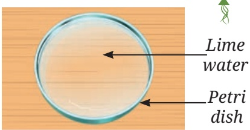
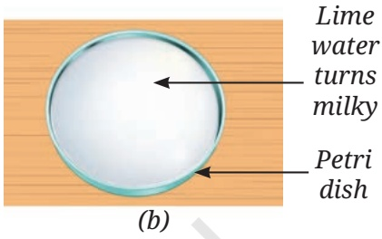
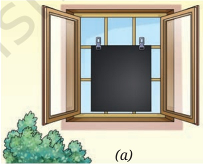
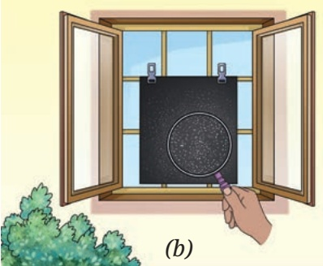

z Stir continuously to make a solution of calcium hydroxide. This solution is called lime water.

z Filter it and observe its colour.

z Leave this colourless solution in a petri dish for a few hours (Fig. 8.5a).

z Keep stirring the solution at regular intervals.

z What do you observe (Fig. 8.5b)?

z Does it turn milky?

Can you **explain** why the solution has turned milky?

You know that lime water turns milky when carbon dioxide reacts with calcium hydroxide to form calcium carbonate (insoluble tiny white particles) and water (Fig. 8.5). Since lime water turns milky when exposed to air, this activity **demonstrates** the presence of carbon dioxide in the air.

(a)

Fig. 8.5: Lime water turns milky in the presence of carbon dioxide

**Calcium hydroxide + Carbon dioxide Calcium carbonate + Water**

Apart from gases, have you ever observed anything else present in the air? Have you ever noticed tiny shining particles moving in a beam of sunlight entering a dark room through a small opening? What are these particles?

## Activity 8.2: Let us explore

Take a black sheet of paper. Ensure that it is free from any visible dust particles.

z Place the black sheet of paper undisturbed near an open window (Fig. 8.6a), or in the garden, for a few hours.

z What do you observe?

You may notice tiny particles settled on its surface. You may use a magnifying glass to **examine** the particles more closely (Fig. 8.6b).

This shows that dust particles are suspended in the air. They are not an integral part of the air and are considered pollutants. The nature and the number of dust particles in the air may vary from time to time and from place to place.

Fig. 8.6: Black sheet of paper (a) with no dust particles; (b) with dust particles

## A step further

The major pollutants present in the air are particulate matter (dust, soot) and gases like carbon monoxide, ozone, nitrogen dioxide, and sulfur dioxide. The **air quality index** (AQI) is a tool used to describe the air quality.

