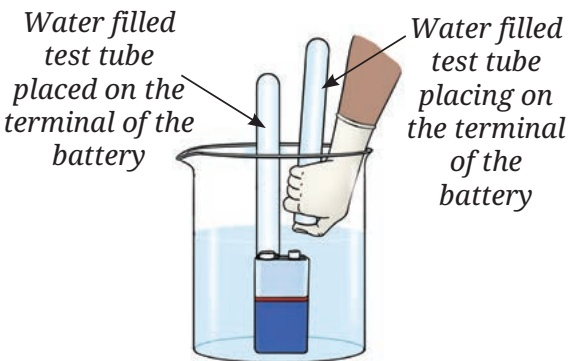
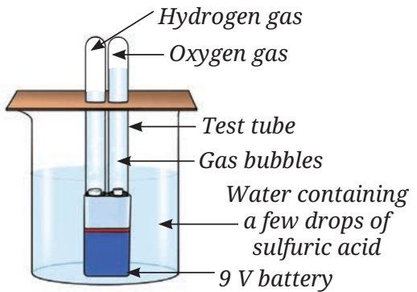
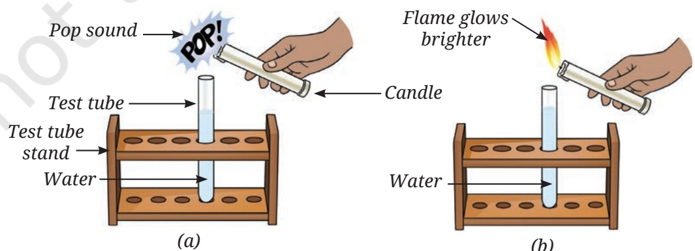

(c) Water filled test tubes placing over the terminals of the battery

(d) Gases collected in the test tubes Fig. 8.8: Passing electricity through water

z Wait for a few minutes.

Do you observe the formation of any gas bubbles at both the terminals inside the test tubes?

z Let it continue for 10–15 minutes.

z Observe the volume of gas collected in each test tube (Fig. 8.8d).

Is the volume of the gas collected the same in both the test tubes?

Remove these test tubes one-by-one carefully.

Test these gases one-by-one by bringing a burning candle close to the mouth of the test tubes.

What happens in each case?

Which gas is present in each test tube?

Can these collected g<u>ases be water vapour</u>?

These gases are not water vapour otherwise they would have condensed back to form <u>water. Let us try to identify these gases.</u>

## Safety first

Perform gas testing with care. Maintain a safe distance from the set-up.

To test the gases present in the two test tubes, bring a burning candle near the mouth of each test tube. A pop sound can be heard from one, indicating the presence of hydrogen gas (Fig. 8.9a). In the other test tube, the flame of the burning candle will glow brighter, confirming the presence of oxygen gas (Fig. 8.9b).

Fig. 8.9: Testing the nature of gas (a) hydrogen; (b) oxygen