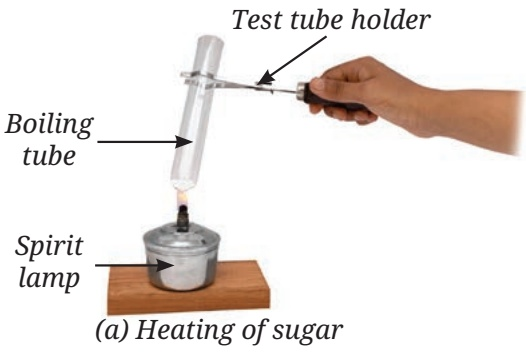
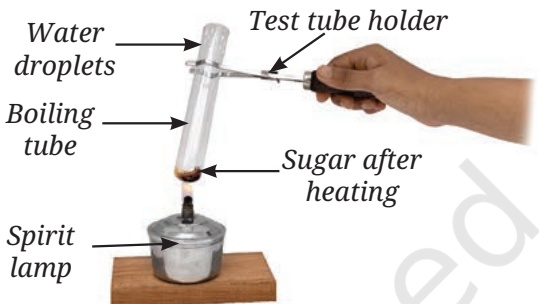
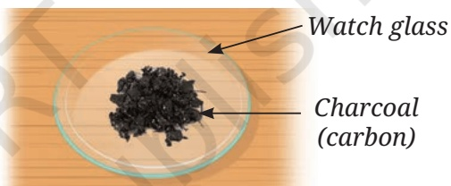
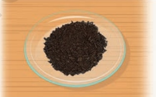
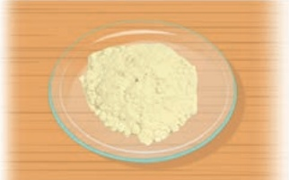

As you heat the sugar, it turns brown (Fig. 8.12b). Later, it begins to char, i.e., it turns blackish (Fig. 8.12c).

You will find small droplets of water inside the boiling tube near its open end. Where did this water come from? Was it in the dry sugar, or did it come by the condensation of water vapour in the air?

Since we are heating the tube, the water must have come from the dry sugar and not from the air. Can you **predict** what is left behind? Charcoal (carbon) is left behind in the boiling tube. You can scoop it out in a watch glass (Fig. 8.12c) and explore if it burns like coal.

Sugar decomposes on heating and gives carbon and water. As you know, water consists of hydrogen and oxygen. Hence, sugar cannot be an element. It may be stated that sugar is a chemical compound consisting of the elements carbon, hydrogen, and oxygen.

Let us explore more about compounds.

(c) Charcoal placed on a watch glass Fig. 8.12: Heating sugar in a boiling tube

## Activity 8.5: Let us experiment (Demonstration activity)

## Safety firstS

This activity may be demonstrated under the supervision of the teacher. It may be performed in a fume hood or a well-ventilated area. Do not inhale the gases.

Take 5.6 grams of iron filings (Fig. 8.13a) and 3.2 grams of sulfur powder (Fig. 8.13b) on a watch glass. Observe them carefully.

(a)

(b)

Fig. 8.13: (a) Iron filings; (b) Sulfur powder