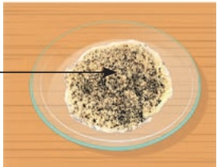
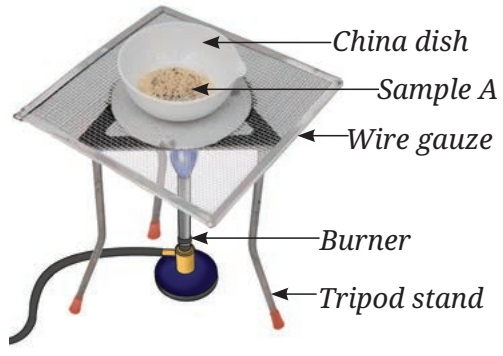
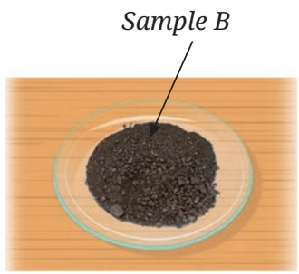
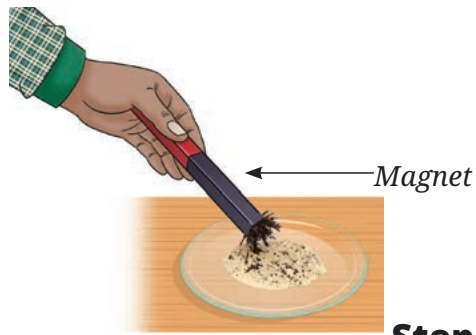
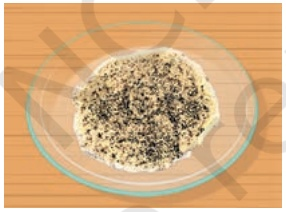
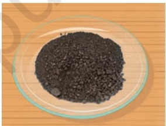
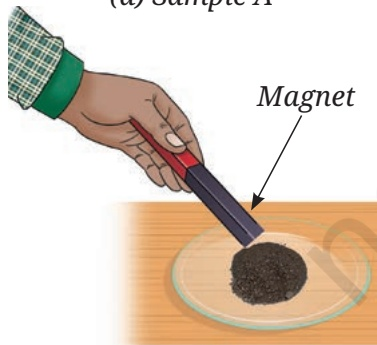

Sample A

Fig. 8.14: A mixture of iron filings and sulfur powder

Mix them thoroughly in a watch glass. Label this mixture as Sample A (Fig. 8.14).

z Observe it carefully.

z Is this a uniform or a non-uniform mixture? Can you still observe both iron and sulfur as separate substances?

(a)

Fig. 8.15: (a) Heating Sample A; (b) Black mass

(b)

Take half of Sample A in a china dish and gently heat it (Fig. 8.15a) with continuous stirring until a black mass is formed.

Let the content of the china dish cool.

Place this black mass in a mortar and grind it with the help of a pestle.

Now, put it on another watch glass and label it as Sample B (Fig. 8.15b).

z Now, you have two samples— Sample A and Sample B (Fig. 8.16a and 8.16b). **Compare** both the Samples A and B step by step and **record** your observations in Table 8.2.

(a)

Fig. 8.16: (a) Sample A; (b) Sample B

(b)

(a) Sample A

## Step 1 — Appearance

(b) Sample B Fig. 8.17: Responses of Samples A and B to a magnet

Compare the appearance of Sample A and Sample B like colour and texture.

## Step 2 — Magnet test

Take a magnet and move it over the Samples A (Fig. 8.17a) and B (Fig. 8.17b), one by one.

What do you observe?

## Step 3 — Gas test

Take a small amount of Sample A in a test tube and add a few drops of dilute hydrochloric acid (Fig. 8.18a).

## Safety first

Be careful while handling hydrochloric acid.

