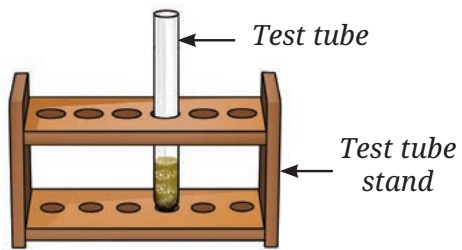
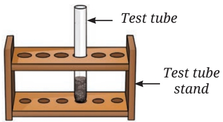
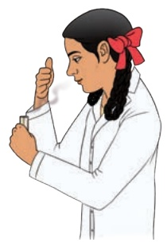
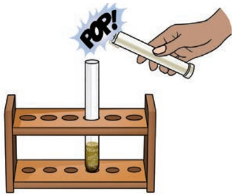
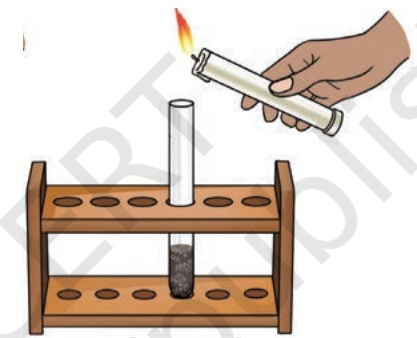

(a) Sample A

Fig. 8.18: Samples A and B in dilute hydrochloric acid

(b) Sample B

Fig. 8.19: Correct way to waft the fumes of an evolved gas

z What do you observe?

Gently smell the evolved gas by wafting it towards your nose (Fig. 8.19).

Test the evolved gas by bringing a burning splinter or a lighted candle near the mouth of the test tube (Fig. 8.20a).

(a) Sample A

**Safety first**

Never smell anything directly.

(b) Sample B

Fig. 8.20: Testing gases

z What do you observe?

Repeat the above steps with Sample B as well (Fig. 8.18b and 8.20b).

## Table 8.2: Comparison of Samples A and B

<table><tbody><tr><td rowspan="2">S.No.</td><td rowspan="2">Experiment</td><td colspan="2">Observations</td></tr><tr><td>Sample A</td><td>Sample B</td></tr><tr><td>1.</td><td>Appearance (i) Colour (ii) Texture</td><td></td><td></td></tr><tr><td>2.</td><td>Magnet test</td><td></td><td></td></tr><tr><td>3.</td><td>Gas test (i) Odour (ii) Burning</td><td></td><td></td></tr></tbody></table>