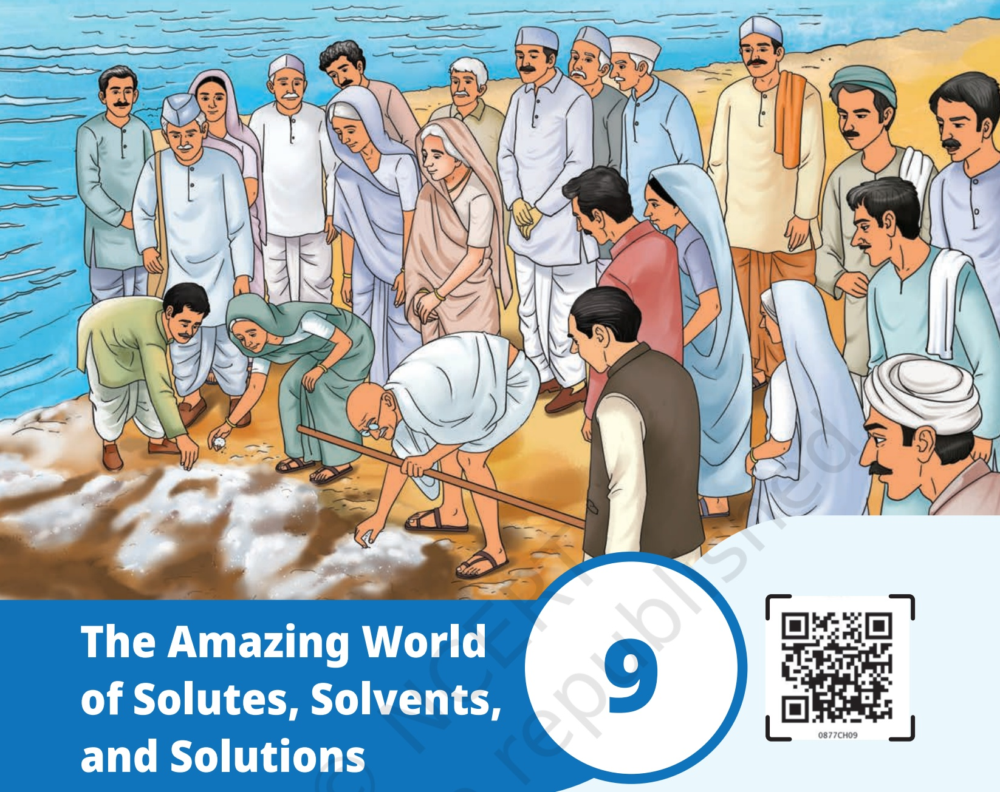
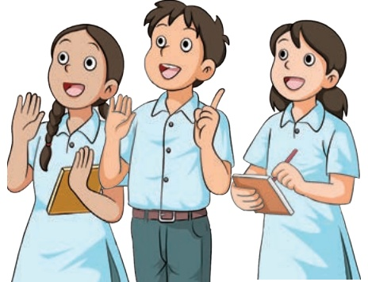

## The Amazing World of Solutes, Solvents, and Solutions

**Probe and ponder**

z What do you think is happening in the picture above?

z What happens when you add too much sugar to your tea and it stops dissolving? How can you solve this problem?

z Why do sugar and salt dissolve in water but not in oil? Why is water considered a good solvent?

z Why are water bottles usually tall and cylindrical in shape instead of spherical?

Share your questions

