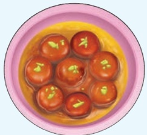

## Ever heard of ...

The Chashni (sugar syrup) of the Indian sweet Gulab jamun is made of a large amount of sugar (solid) dissolved in a small amount of water (liquid). However, the water is still considered as the solvent and sugar as the solute (Fig. 9.4)!

Fig. 9.4: Gulab jamuns dipped in sugar syrup

## 9.2 How Much Solute Can a Fixed Amount of Solvent Dissolve?

## Activity 9.1: Let us investigate

What will happen if we keep on adding more salt in a given amount of water?

Take a clean glass tumbler and fill it half with water.

Add one spoon of salt into it and stir well till it dissolves completely (Fig. 9.5).

z Gradually add a spoonful of salt into the glass tumbler and stir. **Observe** how many spoons of salt you can add before it stops dissolving completely.

z **Record** your observations in Table 9.1.

## ~~Table 9.1: Dissolution of s~~alt in water

| Amount of salt taken(teaspoon) | Observation (salt dissolves/saltdoes not dissolve) |
| --- | --- |
| One |  |
| Two |  |
| Three |  |
| Four |  |
|  |  |

## Some discussion points

z How many spoons of salt were you able to dissolve before some of it remained undissolved?

What does this indicate about the capacity of water to dissolve salt?