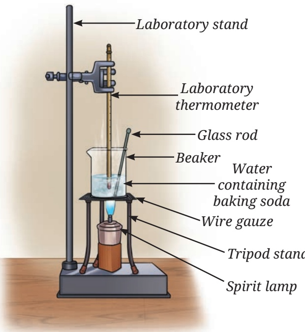
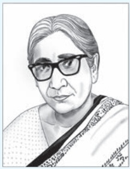

Fig. 9.7: Dissolution of baking soda in water

Now, heat the contents to $5 0 ~ ^ { \circ } \mathrm { C }$ while stirring (Fig. 9.7).

z What happens to the undissolved baking soda?

z You will observe that it has dissolved.

Continue adding more baking soda while stirring at this temperature until some solid baking soda remains undissolved.

Again, heat the contents further to $7 0 \; ^ { \circ } \mathrm { C }$ while continuing to stir. What do you observe?

z The undissolved baking soda dissolves.

Water at $7 0   ^ { \circ } \mathrm { C }$ dissolves more baking soda than water at $5 0 ~ ^ { \circ } \mathrm { C } .$ The amount of baking soda dissolved in water at $2 0 ^ { \circ } \mathrm { C }$ is even lesser.

It has been found that for most of the substances, the solubility increases with an increase in temperature. We can also say that a saturated solution at a particular temperature behaves as an unsaturated solution if the temperature is increased.

## Our scientific heritage

Water has primarily been used as a solvent for the preparation of medicinal formulations in Ayurveda, Siddha, and other traditional systems of medicine in India. Additionally, drug formulations have been prepared using hydro-alcoholic extracts of the herbs. The Indian systems of medicine have also referred to the use of oils, ghee, milk, and other substances as solvents for drug formulations, to help achieve the therapeutic benefits of the drug.

## Be a scientist

## What inspired Asima Chatterjee to work on medicinal plants?

Asima Chatterjee is renowned for her work in developing anti-epileptic and anti-malarial drugs. She used solvents and solutions extensively to extract and isolate important compounds from medicinal plants. She earned a Doctorate of Science, becoming the second Indian woman to do so after Janaki Ammal. She became the first woman to receive the Shanti Swarup Bhatnagar Award in the field of chemical science and was also honoured with the Padma Bhushan.

