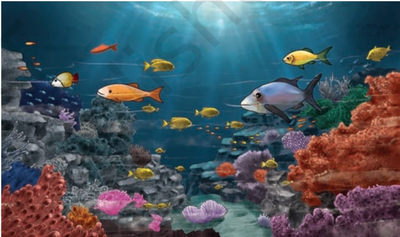

Do gases also dissolve in water?

## 9.3 Solubility of Gases

Many gases, including oxygen, dissolve in water. Oxygen dissolves in water only to a small extent. Even though present in minute quantities, it is this dissolved oxygen that sustains all aquatic life, including plants, fishes, and other organisms.

Is the mixture of gases in water a uniform or non-uniform mixture?

It is a uniform mixture because the gases dissolve evenly in water.

Does temperature affect the solubility of gases in liquids also? If so, how?

It has been observed that the solubility of gases generally decreases as temperature increases. More oxygen can dissolve in cold water, ensuring sufficient oxygen for aquatic life (Fig. 9.8). On the other hand, when water warms up, the solubility of oxygen decreases.

Fig. 9.8: Aquatic species in water

Now I understand that the mixtures we use can be of two types—uniform and non-uniform. Uniform mixtures are called solutions, and their components are not visible separately. In non-uniform mixtures, the components can be seen either with the naked eye or with a magnifying device.

I observed that in some non-uniform mixtures, such as sawdust in water, the sawdust floats, whereas in the mixture of sand and water, the sand sinks. I wonder why that happens?

