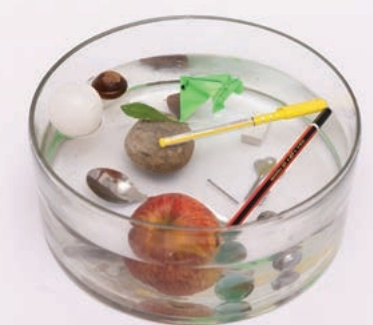

# 9.4 Why Do Objects Float or Sink in Water?

Fig. 9.9: Some objects float while others sink in water

You must have observed that some objects float while others sink in water (Fig. 9.9). You may have noticed that, while washing rice, husk particles present in the rice float on the surface of water while rice sinks to the bottom of the container. Why does this happen? If you add oil to water, it floats on water. Generally, it is believed that objects that **float** in a liquid are lighter and others that **sink** are heavier than the liquid.

A wooden stick and an iron rod may be of the same size, yet the iron rod feels much heavier. When we say that iron is heavier than wood, we are referring to a special property

known as density, which describes the heaviness of an object.

## Note

However, the density of a substance is not the only factor that decides whether it will float or sink in a particular liquid.

Let us explore further.

Fig. 9.10 (a): Dense forest

## 9.5 What Is Density?

Imagine a crowded bus where many people are packed together—this is an example of high density whereas, the same bus with only a few people is an example of low density. Similarly, a forest where trees grow close to each other is called a dense forest (Fig. 9.10a), but if the trees are far apart (Fig. 9.10b), it is considered less dense.

Fig. 9.10 (b): Less dense forest

## How do scientists define density?

Let us find out.

We have learnt that matter is anything that possesses mass and occupies space (volume). **Density** is defined as the mass present in a unit volume of that substance.

The density of a substance may be expressed mathematically using the formula:

$$
{ \mathrm { D e n s i t y } } = { \frac { \mathrm { M a s s } } { \mathrm { V o l u m e } } }
$$

The density of a substance is independent of its shape or size. However, it is dependent on temperature and pressure. Pressure primarily affects the density of gases, while its effect on solids and liquids is negligible.