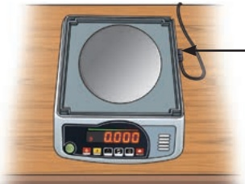
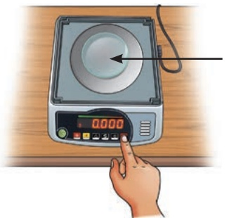
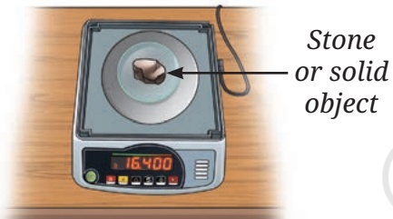
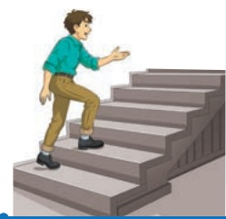
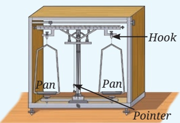

You may measure the mass by doing the following activity.

## Activity 9.3: Let us measure

Fig. 9.12(a): Digital weighing balance

Fig. 9.12(b): Tare the balance after placing a watch glass

## Digital

## weighing balance

z Switch ON the digital weighing balance.

Observe the initial reading on the digital weighing balance display.

It should show a zero reading. If not, then we must bring it to zero by pressing the tare or reset button (Fig. 9.12a).

Place a dry and clean watch glass or butter paper on the pan.

z Note the reading on the digital weighing balance.

Reset the digital weighing balance reading to zero by pressing the tare or reset button as shown in Fig. 9.12b.

Now, carefully place the solid object, such as stone, on the watch glass (Fig. 9.12c).

z Note the reading displayed on the balance, which gives the mass of the stone, say 16.400 g.

Fig. 9.12(c): Weighing a solid object on digital balance

(You may use any other type of balance available in your school.)

## Note

The mass of a liquid may be measured by replacing the watch glass with a beaker and pouring the desired amount of liquid into it.

## A step further

As mentioned in Chapter 5, the words ‘mass’ and ‘weight’ are often used interchangeably in everyday language. But they have different meanings in science, which can sometimes cause confusion. Mass is the quantity of matter present in an object or a substance. Its units are gram (g) and kilogram (kg). On the other hand, weight is the force by which the Earth attracts an object or a substance towards

Fig. 9.13: Two-pan balance

itself, and it is measured in newtons (N). Most balances (except two-pan balances like in Fig. 9.13) actually measure weight, but their scales are marked in mass units, so they show values in grams or kilograms (Fig. 9.12c).