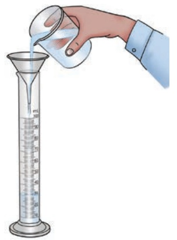
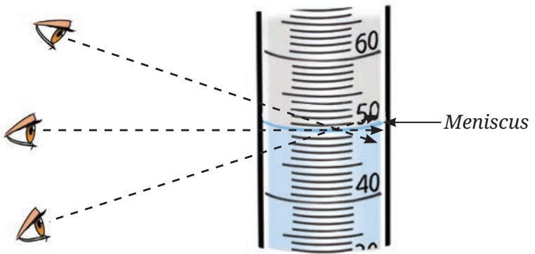
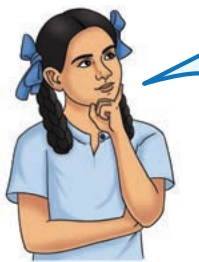

z Make sure that the eyes are at level with the bottom of the meniscus while noting the readings as shown in Fig. 9.18.

Fig. 9.17: Pouring water into the measuring cylinder

Fig. 9.18: Measuring the reading

I wonder how the level of a coloured liquid is measured?

Once it reaches the required level—that is, 50 mL— transfer this water to the required container.

In case of coloured liquids the mark on the measuring cylinder should coincide with the top of the meniscus!

## Determining volume of solid objects with regular shapes

## Activity 9.6: Let us calculate

**Collect** various objects with a cuboid shapes, such as a notebook, a shoe box, or a dice.

z Measure the length (l), width (w), and height (h) of the objects using a scale. Suppose the length of the notebook is 25 cm, the width is 18 cm, and the height is 2 cm.

z **Calculate** the volume by using the following formula.

$$
\mathrm{Volume} = l \times w \times h
$$

$$
\mathrm{Volume}=25\mathrm{~cm}\times18\mathrm{~cm}\times2\mathrm{~cm}=900\mathrm{~cm}^{3}
$$

z Record in your notebook.

## Determining volume of objects with irregular shapes

Imagine you have an object, like a stone, that does not have a regular shape. To calculate its density, the main challenge is to find its volume. Let us learn how the volume of a solid with an irregular shape can be determined.