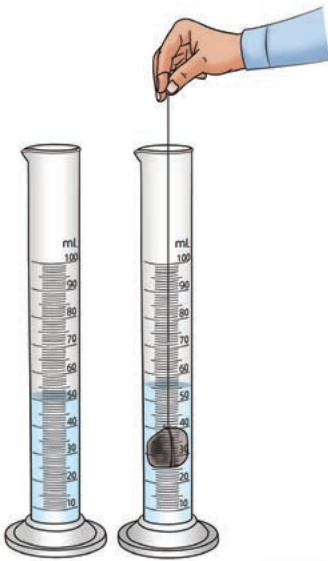
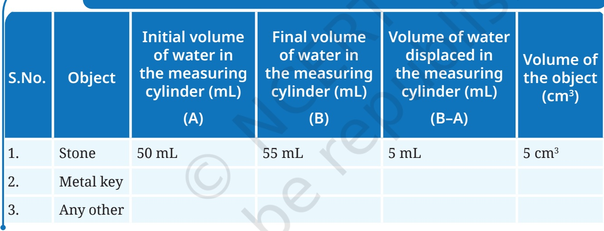

Fig. 9.19: Level of water in the measuring cylinder (a) Without object; (b) With object

## Activity 9.7: Let us measure

z Collect various objects from your surroundings, such as a stone, metal keys, and so on.

z Fill a measuring cylinder with water up to any desired volume, say 50 mL (Fig. 9.19a) and record the initial volume taken in Table 9.2.

Tie the object, say a stone, with a thread and slowly lower it into the measuring cylinder.

z What do you notice?

z Record the final volume after the level rises, say 55 mL, as shown in Fig. 9.19b.

z Subtract the initial volume from the final volume after the object is put into the measuring cylinder. This is the volume of the object.

z Record your observations in Table 9.2.

~~Table 9.2: Volume o~~f irregular solids

## Note

The values of volume are obtained in units of mL, which can be written in the equivalent unit cm3 for solids.

We have already learnt to measure the mass and volume of liquids and solids of different types. These quantities can be used to calculate the density of the object or the substance.

## Let us calculate the density

Density can be calculated using the following formula:

$$
\mathrm{Density} = \frac{\mathrm{Mass}}{\mathrm{Volum}} = \frac{16.400\ \mathrm{g}}{5\ \mathrm{cm}^3} = 3.28\ \mathrm{g/cm}^3
$$