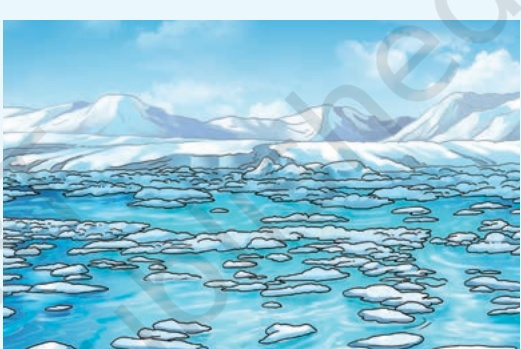
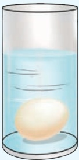

## 9.5.3 Effect of pressure on density

Pressure affects density differently depending on the state of matter. For gases, increasing pressure causes the particles to move closer together. As a result, the volume of the gas decreases and its density increases. In the case of liquids, pressure has a small effect because they are nearly incompressible. We have learnt in chapter ‘Particulate Nature of Matter’ that the particles in solids are very close to each other. So, how is the density of solids affected when pressure is applied? Solids are even less affected by pressure than liquids, and changes in their density are usually negligible.

## Ever heard of ...

Why does ice float on water? Ice floats on water because it is lighter than liquid water (Fig. 9.23). Water has a special property that its density is highest at 4 °C. As the temperature drops, and water turns into ice at 0 °C, it undergoes a change in structure—the particles arrange themselves in a way

Fig. 9.23: Ice floats on water

that takes up more space. This process is called expansion. Because the same amount of water now occupies a larger volume, its density decreases. As a result, ice becomes lighter than liquid water and floats on its surface.

This is important for animals living in lakes and oceans because ice floats, it forms a layer on top, keeping the water underneath warm enough for fish and other creatures to survive, even in extremely cold weather.

## Think like a scientist

Take a glass tumbler and fill it with tap water. Carefully place a raw whole egg into the water and observe what happens. You will notice that the egg sinks to the bottom (Fig. 9.24).

What change can you make to this setup to make the egg float in water instead of sinking?

In this chapter, you have learnt the concept of density and how it explains partially why some objects float while others sink.

Fig. 9.24: Raw whole egg sinks in water