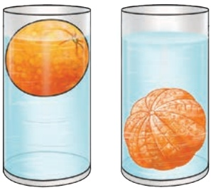

2. Fill in the blanks.

(i) The volume of a solid can be measured by the method of displacement, where the solid is in water and the in water level is measured.

(ii) The maximum amount of dissolved in at a particular temperature is called solubility at that temperature.

(iii) Generally, the density with increase in temperature.

(iv) The solution in which glucose has completely dissolved in water, and no more glucose can dissolve at a given temperature, is called a solution of glucose.

3. You pour oil into a glass containing some water. The oil floats on top. What does this tell you?

(i) Oil is denser than water

(ii) Water is denser than oil

(iii) Oil and water have the same density

(iv) Oil dissolves in water

4. A stone sculpture weighs 225 g and has a volume of 90 cm3. Calculate its density and predict whether it will float or sink in water.

5. Which one of the following is the most appropriate statement, and why are the other statements not appropriate?

(i) A saturated solution can still dissolve more solute at a given temperature.

(ii) An unsaturated solution has dissolved the maximum amount of solute possible at a given temperature.

(iii) No more solute can be dissolved into the saturated solution at that temperature.

(a)

Fig. 9.25

(b)

(iv) A saturated solution forms only at high temperatures.

6. You have a bottle with a volume of 2 litres. You pour 500 mL of water into it. How much more water can the bottle hold?

7. An object has a mass of 400 g and a volume of 40 cm³. What is its density?

8. Analyse Fig. 9.25a and 9.25b. Why does the unpeeled orange float, while the peeled one sinks? Explain.

9. Object A has a mass of 200 g and a volume of 40 cm³. Object B has a mass of 240 g and a volume of 60 cm³. Which object is denser?

**Prepare some questions based on your learnings so far ...**.................................................................................................................................................................................................................................................................................................................................................. ............................................................................ Reprint 2026-27