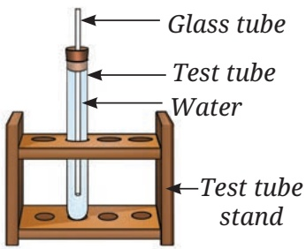
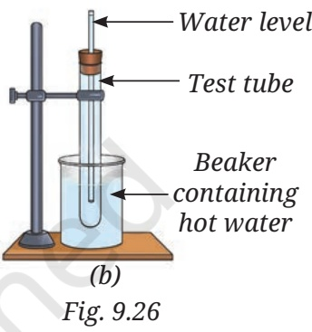

10. Reema has a piece of modeling clay that weighs 120 g. She first moulds it into a compact cube that has a volume of 60 $\mathbf { c m } ^ { 3 }$ . Later, she flattens it into a thin sheet. Predict what will happen to its density.

11. A block of iron has a mass of 600 g and a density of 7.9 g/cm³. What is its volume?

(a)

12. You are provided with an experimental setup as shown in Fig. 9.26a and 9.26b. On keeping the test tube (Fig 9.26b) in a beaker containing hot water $( \sim 7 0 ~ ^ { \circ } \mathrm { C } )$ , the water level in the glass tube rises. How does it affect the density?

## Discover, design, and debate

z Research project on Dead Sea: Why is there no aquatic life in the Dead Sea? Try to find out if there are any other similar water bodies.

Investigate how well common salt dissolves in different solvents, such as water, vinegar, and oil. Compare the solubility of salt in each solvent and record your observations.

Debate in class — Is water truly the most versatile solvent?

## Our scientific heritage

Ningel village in Manipur’s Thoubal district is a place where salt is still produced using traditional methods. The village has a few salt wells, one of which is lined with a 100-year-old tree trunk placed into the ground to draw up salty water. A few families mostly women, continue this sacred practice by collecting the salt solution and boiling it in large metal pans over firewood kilns. Once the water evaporates and salt crystals form, they are shaped into round ‘salt cakes’ using banana leaves and handmade tools. These cakes are then wrapped in a traditional cloth (phanek) to protect them. The salt cakes are believed to have some medicinal value too.

Salt in Ningel is more than just food — it is history, culture, belief, and a beautiful example of India’s living heritage.

## Reflect on the questions framed by your friends and try to answer ..

