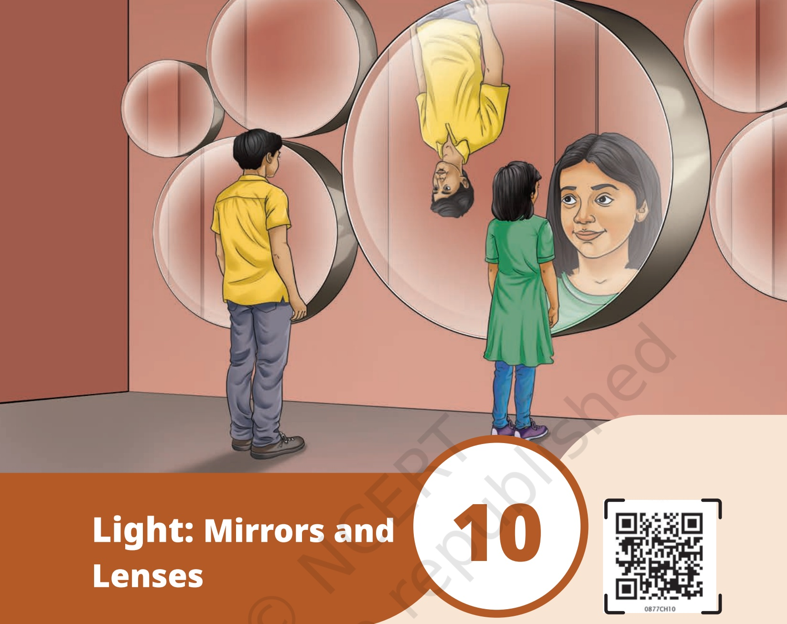

## Light: Mirrors and Lenses

z Can we make mirrors which can give enlarged or diminished images?

z On side-view mirrors of vehicles, there is a warning that says “Objects in mirror are closer than they appear”. Why is this warning written there?

z Why is there a curved line on some reading glasses?

z Share your questions