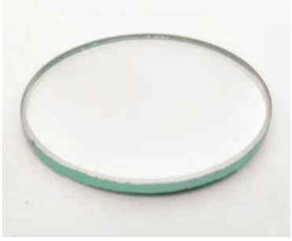
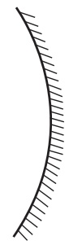
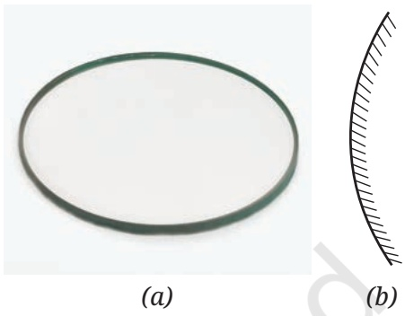
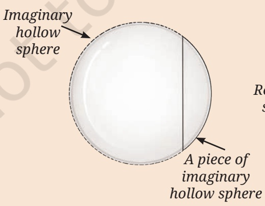
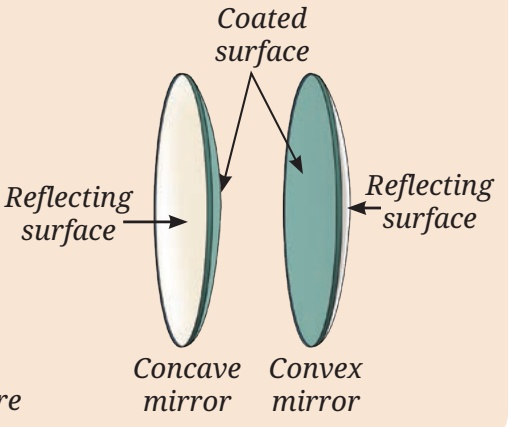

The reflecting surface of the spherical mirror may be curved inwards or outwards. A spherical mirror, which has a reflecting surface that curves inwards, is called a **concave mirror** (Fig. 10.2a). Its schematic representation is shown in Fig. 10.2b. The outline of the surface of the mirror is circular.

(a)

Fig. 10.2: (a) Concave mirror; (b) Its representation

(b)

Fig. 10.3: (a) Convex mirror; (b) Its representation

A spherical mirror which has a reflecting surface that curves outwards is called a **convex mirror** (Fig. 10.3a). Its schematic representation is shown in Fig. 10.3b.

In the representation of both the mirrors, the non-reflecting surface of the mirror is shown as shaded.

## A step further

The shape of a spherical mirror is such that it can be thought of as a part of an imaginary hollow sphere. However, remember that spherical mirrors are not made by slicing a hollow glass sphere. Instead, they are created by grinding and polishing a flat glass piece into a curved surface. If a reflective coating (like a thin layer of aluminium) is applied on the outer curved surface, it forms a concave mirror. If the coating is applied on the inner curved surface, it forms a convex mirror.

